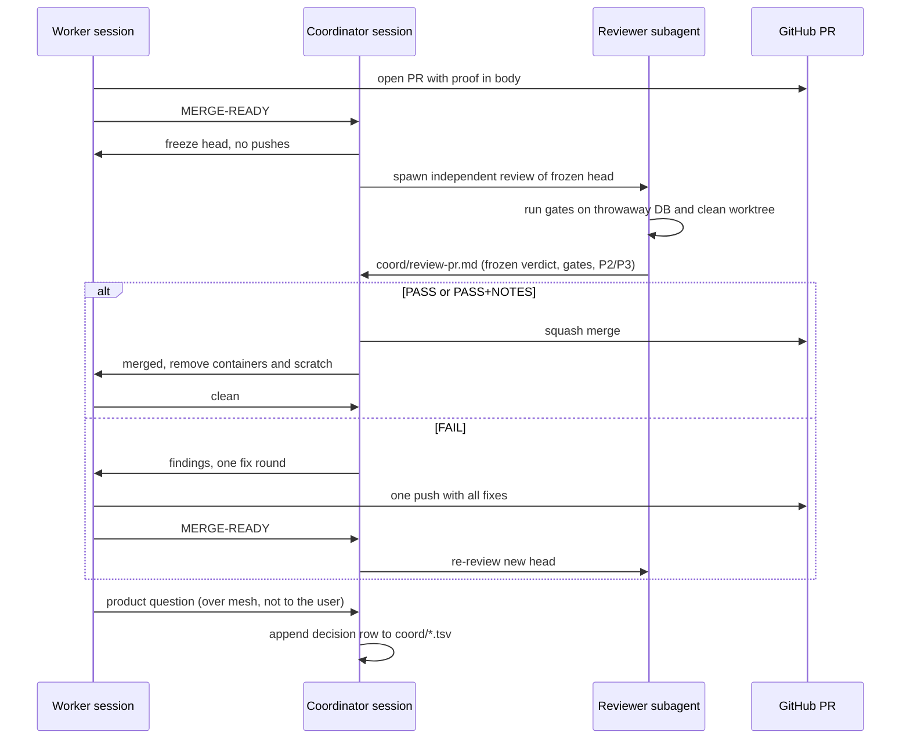
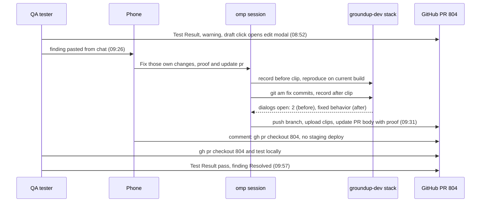

# Reference digest: omp mesh, coordinator sessions, omp on the phone

Three talk topics. Topic 4 covers the omp mesh, the built-in way parallel sessions on one machine avoid stepping on each other. Topic 7 covers the coordinator session, an ordinary omp session that drives SHIP and MERGE rounds through mesh, `gh`, TSV ledgers and independent reviewer subagents. Topic 8 covers a real bug fix driven from a phone, GinaV2 PR #804, with a 65-minute loop from QA finding to QA pass.
Times are WIB (UTC+7) unless marked UTC. Evidence paths are on the author's workstation. Items marked [UNVERIFIED] or [INFERENCE] were not confirmed on disk.
Customer and project names are replaced with generic labels. The coordinator ledger directory is written as `~/work/<project>/coord/`.

## Topic 4: omp mesh

### Key facts

- Many omp sessions run on one machine and share one set of ports, one Docker daemon and one checkout. Mesh exists so two agents do not run the same heavy job or edit the same file. `~/.omp/agent/AGENTS.md` (section "Multi-agent coordination (mesh)").
- Mesh is a built-in omp tool named `mesh`. It is also reachable as the write target `xd://mesh` with a JSON body such as `{"action":"send","to":"<name>","body":"..."}`. Session transcripts under `~/.omp/agent/sessions/`.
- Rules in the global AGENTS.md, paraphrased from the file. `~/.omp/agent/AGENTS.md`
  - Run `peers` before work that touches shared resources.
  - Keep a `note` current with what you do and which ports and containers you hold.
  - Check a port is free with `ss -ltn` before binding. If taken, pick another and post it in a note.
  - For heavy shared work (docker, e2e, migrations, full builds), if a peer shows the same work, `send` a message and wait instead of running in parallel.
  - Claim files outside your own worktree with `claim`, and `release` when done. Edits to files another agent claimed are blocked automatically.
  - If a change affects a peer's API, schema or shared config, message them.
  - `broadcast` defaults to the repo group. `scope: "all"` goes machine-wide. `send` accepts a handle or a title card such as `PLAN`.
- Actions: `peers`, `note`, `send`, `broadcast`, `claim`, `release`, `join`, `leave`, `feed`. `feed` and `broadcast` were observed in tool calls. `~/.omp/agent/AGENTS.md` and session transcripts.
- On-disk shape. `~/.omp/agent/mesh.json`, `~/.omp/agent/mesh/`
  - `~/.omp/agent/mesh.json` holds `{"roots": ["~/work/*", "~/.omp/wt/*"]}`. A session joins only if its cwd is under a root.
  - `mesh/feed.jsonl` is an append-only event log. It had 10,083 lines on 2026-11-05. Event types seen: `join`, `leave`, `message`, `claim`, `blocked`, `edit`.
  - A feed line looks like `{"ts":"...","type":"claim","agent":"<name>","target":"<path>","preview":"smoke test"}`.
  - `mesh/agents/<session-uuid>.json` is one registry file per live session. Fields include `name`, `branch`, `cwd`, `group`, `model`, `status`, `subagents`, `title`, `reservations`, `recent`, `updatedAt`.
  - `mesh/inbox/<session-uuid>.jsonl` is a per-agent inbox. Lines carry `at`, `body`, `broadcast`, `from`, `to`. Roughly 100 inbox files exist.
  - Agent names are generated, for example `EagerBadgersReply` or `TwelveCitiesCross`.
- Delivery. A direct message arrives in the receiving transcript as `customType: "mesh-message"`. A broadcast arrives as `mesh-broadcast`. A `send` returns a receipt such as `"outcome":"injected"`. A running `wait` call is cut short when mesh mail arrives ("Wait interrupted by message."). Session `2026-11-03T05-20-37-609Z_01a19fda...jsonl`, lines 372, 757, 929.
- Usage. 101 session files contain `"tool":"mesh"`. Counted by grep over `~/.omp/agent/sessions`. Per-action counts were not collected.
- Limit. A session outside the configured roots, or a subagent, gets `MESH_NOT_JOINED`. Transcript `-.local-share-worktrees-...-PRODU-114/2026-10-28T01-53-20-012Z_01a18036...jsonl`, line 384.
- Conflict between inputs [INFERENCE]. `mesh.json` lists `~/.omp/wt/*` as a root, yet the SHIP coordinator saw `MESH_NOT_JOINED` for workers in worktrees under `~/.omp/wt`. The roots file and live behavior may differ. Check before claiming either on stage.
- Workaround used by the coordinator. When mesh refused worktrees, it typed into the worker's Tern tab and read the worker's session file. It also told workers: end each update with a plain line `MERGE-READY #<pr> <full sha>` and "I will see it." SHIP session in `~/work/<project>/`.
- Why messages alone are not enough. Idle sessions do not wake on mesh messages. A session that has ended never sees a broadcast. So each branch gets one writer, and a dead owner is replaced by a fresh one. `~/work/<project>/coord/2026-11-03-ship.tsv`, row 2026-11-02T17:12:50Z.
- Message patterns seen in inbox samples (bodies not copied, they contain customer data). `~/.omp/agent/mesh/inbox/`
  - Handoff: `MERGE-READY #<PR> <sha>` with gates and proof.
  - Reviewer: `HEAD #<PR> <sha>`, then a `FIX` or `CLEAN` verdict.
  - Cleanup: stop stacks, free ports, remove the worktree, close the tab, reply `CLEANED`, then `mesh leave`.
  - Subagents must use a scratch commit or a second worktree for red runs, and must not `git stash`.

### Story/example

On 2026-11-03 a worker session on an auth-impersonation feature finished PR #523 and sent `MERGE-READY #523 <sha>` to the coordinator over mesh, saying CI was green and a reviewer was next. The worker then re-sent the message with a new head after one more push. The coordinator answered that two independent reviewers (security and product) found a FAIL at the frozen head, and pointed to a findings file in `coord/`. A reviewer subagent was spawned with `task`, and the coordinator injected a follow-up into it with `write agent://<name>`, which returned `Delivered`. The whole loop sits in lines 814 to 961 of one transcript and takes about three minutes to walk through. Earlier in the same session the worker had posted a `note` saying it used no docker, no shared ports and no repo source edits, which is the port-and-container announcement the rules ask for.

### Show on screen

- `~/.omp/agent/AGENTS.md`, the "Multi-agent coordination (mesh)" section.
- `cat ~/.omp/agent/mesh.json`
- `tail -n 5 ~/.omp/agent/mesh/feed.jsonl` (safe if previews are short. Check before showing, previews can contain task text).
- `ls ~/.omp/agent/mesh/agents | wc -l` (count only).
- Live: call the `mesh` tool with action `peers` from a session.
- Failure demo: the `MESH_NOT_JOINED` text and the `mesh.json` roots fix.
- Do not open `mesh/inbox/` files on stage. They hold other repos' staff and customer data.

### Quotable

```
Other omp agents may be running in other sessions. Run the `mesh` tool with action `peers`
before work that touches shared resources.
```
(`~/.omp/agent/AGENTS.md`)

```
Before editing files outside your own worktree, claim them with `mesh` action `claim`.
Release with action `release` when done. Edits to files another agent claimed are blocked automatically.
```
(`~/.omp/agent/AGENTS.md`)

```
MESH_NOT_JOINED: this session is not on the mesh (its cwd is outside the configured roots,
or it is a subagent). Fix: start omp under a root listed in ~/.omp/agent/mesh.json.
```
(tool result, transcript line 384)

```
idle sessions don't wake on mesh messages; each branch needs one writer.
```
(`~/work/<project>/coord/2026-11-03-ship.tsv`)

## Topic 7: Coordinator session

### Key facts

- A coordinator is an ordinary omp session, not a daemon. It uses `mesh` (`peers`, `send`, `feed`, `broadcast`), `gh`, and TSV ledgers. Example session titles: "MERGE: Coordinate agents to merge all PRs" (2026-10-25 and 2026-10-26) and "SHIP: Show PR link and UI coverage" (2026-11-02 to 2026-11-05). `~/.omp/agent/sessions/` and the SHIP session in `~/work/<project>/`.
- SHIP prompts seen in history. "coordinate MAKTAB and SCOPE so they ship PR properly" (those are worker lane names). "the other that already green you can merge it first, but deploy prod later". Another asks the coordinator to spawn a Tern worktree plus a fresh omp session and prompt it to fix the findings worth picking up.
- Coordinator identity on mesh was a generated handle (`LoudDotsSit` in the SHIP flow). Product questions from workers go to that handle, not to the human. `~/work/<project>/coord/2026-10-29-merge-queue.tsv`, rows 13 to 15.
- Worker contract, from the worker prompt. `~/work/<project>/coord/2026-10-29-merge-queue.tsv`, rows 13 to 15
  - Do not merge.
  - Send a line `MERGE-READY #<pr> <full sha>` when ready.
  - Freeze the head after that. An independent reviewer reviews that head.
  - The coordinator relays findings for at most one fix round, and the worker puts everything in one push.
  - Product questions go to the coordinator over mesh, not to the user.
  - When the coordinator says merged, remove containers, worktree scratch, and reply `clean`.
- Reviewers are independent subagents spawned with `task` (for example `Review523Fix`), waited on with `wait`, and sometimes nudged with `write agent://<name>`. For #523 two reviewers ran, one on security and one on product. Transcript `2026-11-03T05-20-37-609Z_01a19fda...jsonl`, lines 914 to 929.
- Ledger directory `~/work/<project>/coord/` holds 80 files. Types: TSV ledgers, `review-<pr>.md` reports per PR and round, morning reports, a brief, and `prompts-2026-11-04/` worker prompts.
- TSV columns, verified from the header line: `ts`, `phase`, `decision`, `why`, `evidence`, `result`. The ship ledger `2026-11-03-ship.tsv` has 276 lines.
- Gate rules written in the merge-queue ledger rows 2 to 5. `~/work/<project>/coord/2026-10-29-merge-queue.tsv`
  - The coordinator took over for 8 peer sessions plus one more PR. The user asked every agent to open a PR with proof, get independent review, and squash merge when clean.
  - Verifiers do not launch their own dev stacks. The machine had 14 GiB available and the verify script refuses below 15 GiB.
  - Stale PRs stay open until the user decides.
  - Proof scaled down to one verify spec per PR, and the coordinator runs one reviewer.
- Review report shape, example `coord/2026-11-05-review-580.md`. Header line: "Frozen verdict: PASS+NOTES at head 592b92ae9". Then a gates table. Rows include the `verify.ts` verdict (PROVEN: red run on master, green on head, desktop 1280 en-US and mobile 390 id-ID), merge-tree clean, check-types, lint:arch baseline, and unit and e2e counts on a throwaway database that was removed afterwards. Then Product/UX findings tagged P2 or P3, each with confidence, file:line, and a fix.
- Operator gates stay with the human. Example row 2026-11-03T15:26:35Z: the operator says "merge finished work, clean up locally, close tabs". The coordinator also holds back prod deploys on the user's call. `~/work/<project>/coord/2026-11-03-ship.tsv`.

### Real ledger rows

Quoted from the ship and merge-queue ledgers. Customer names removed.

- `started fresh owners for #488... because their sessions had ended and never saw the broadcast | idle sessions don't wake on mesh messages; each branch needs one writer`
- `#490 FAIL: README dvc pull command errors when run as written | ran the README verbatim in a clean worktree`
- `#492 FAIL: staging mask leaks most PII, reset rerun can drop the only prior live DB | proven on throwaway PG by reviewer`
- `decided #492 does not gate the release | devkit-only CLI; nothing in prod images changes`
- Worker messages in prompt history. "#549 round 1: FAIL at 76bcdaf2b (report coord/2026-11-04-review-549.md)... One fix round, everything in one push". "#544 round 1: PASS+NOTES ... Proof red on pre-#535, green on head".

### Story/example

On 2026-11-02 the SHIP coordinator broadcast a plan for PR #488. Hours later it found the owners never acted on it, because their sessions had ended and an idle session does not wake on mesh mail. It started fresh owners and wrote the reason into the ledger as a decision row. The same ledger shows the other half of the discipline. PR #490 failed review because the reviewer ran the README command verbatim in a clean worktree and it errored. PR #492 failed because a reviewer proved on a throwaway Postgres that the staging mask left most PII and a rerun could drop the only prior live database. The coordinator then ruled that #492 did not gate the release, since it was a devkit-only CLI and no prod image changed. Each of those calls is one TSV row with a reason and evidence.

### Diagram: coordinator loop



### Show on screen

- `less ~/work/<project>/coord/2026-10-29-merge-queue.tsv` (rows 2 to 5 for gate rules, rows 13 to 15 for the worker contract).
- `less ~/work/<project>/coord/2026-11-03-ship.tsv` (row 2026-11-02T17:12:50Z for why mesh alone is not enough).
- `~/work/<project>/coord/2026-11-05-review-580.md` (frozen verdict line and gates table). Check for customer names before showing.
- Transcript `~/.omp/agent/sessions/-.omp-wt-feat-auth-impersonate-f5eade8/2026-11-03T05-20-37-609Z_01a19fda...jsonl`, lines 814 (MERGE-READY), 914 (FAIL), 923 (reviewer spawned).
- `ls ~/work/<project>/coord | wc -l` (80 files).

### Quotable

```
Do not merge. Freeze the head after that: an independent reviewer reviews it, and the
coordinator relays findings for at most one fix round.
```
(worker prompt, `2026-10-29-merge-queue.tsv`)

```
Product questions go to the coordinator over mesh, not to the user.
```
(same ledger, paraphrase from rows 13 to 15)

```
end each update with a plain line 'MERGE-READY #<pr> <full sha>' and I will see it.
```
(coordinator prompt to workers in the SHIP session)

```
Frozen verdict: PASS+NOTES at head 592b92ae9
```
(`coord/2026-11-05-review-580.md`)

## Topic 8: omp on the phone, GinaV2 PR #804

### Key facts

- The phone screenshot shows a chat-style omp transcript titled "SENSOR: Fix sensor mapping an...", a mic composer, and a 9:29 clock. `screenshot-omp-mobile-0929.png` in this folder.
- The session is "SENSOR: Fix sensor mapping and OTA text", created 2026-10-26 09:21 in a worktree named `fix-sensor-assign-ota-remnant`. Model `anthropic/claude-opus-5-5`, thinking high. `~/.omp/agent/sessions/-.omp-wt-fix-sensor-assign-ota-remnant-d3c9633/2026-10-26T02-21-39-596Z_01a17603...jsonl`, lines 1 to 6.
- First prompt pasted the QA report from WhatsApp and asked the agent to test on the dev server and own the proof: "...so later on PR i can have proof screenshot or recording on the body own all the changes poteto". Same session.
- PR #804 opened 2026-10-26 10:00 and approved by a reviewer at 14:56. Branch `fix/sensor-assign-ota-remnant`. Issue #803. Squash commit `618c3a9f` on main. `https://github.com/groundup-ai/GinaV2/pull/804`
- The fix was applied to the dev stack with `git format-patch ... | ssh groundup-dev "cd ~/ginav2-main && git am"`. Session line 548.
- PR body sections: Why (6 numbered issues), Scope, Tradeoffs, Blast Radius, Verification with before/after tables and videos per issue. Each issue was reproduced on base first, then checked on the branch with the same recording. Label "Tested - Pass". PR #804 body.
- Voice input is configured: `stt: {enabled: true, submitTrigger: say-submit}`, so "say submit" sends the prompt. The mic is visible in the screenshot. `~/.omp/agent/config.yml`. The typos in the user prompts that morning show phone typing.
- `remote` in `config.yml` is a compaction method, not a mobile bridge. Do not present it as one.

### PR #804 timeline (WIB)

| Time | Event |
| --- | --- |
| 2026-10-26 09:21 | Session created, QA report pasted |
| 2026-10-26 10:00 | PR #804 opened |
| 2026-10-26 14:56 | Reviewer approves |
| 2026-10-27 08:52 | QA posts Test Result with status warning and one "Additional Finding". Clicking a draft sensor opens the edit modal. |
| 2026-10-27 08:42 to 09:26 | Prompts from the phone, including other work in the same session |
| 2026-10-27 09:26 | QA's finding pasted: "Fix those own changes proof and update pr" |
| 2026-10-27 09:27 | Fix committed. "Before" recording starts on the groundup-dev stack. |
| 2026-10-27 09:29 | Before screenshot. Agent: "That reproduces the issue". Phone screenshot clock reads 9:29. |
| 2026-10-27 09:29 | Fix applied on dev, "after" recording starts |
| 2026-10-27 09:30 | Proofs uploaded, branch pushed |
| 2026-10-27 09:31 | PR body updated with item 6 (proof). Zahid comments on the PR telling QA to `gh pr checkout 804` rather than use staging. |
| 2026-10-27 09:39 | Prompt: "We wont deploy staging aji will pull and test on pr" |
| 2026-10-27 09:57 | QA posts Test Result with status pass. Finding marked Resolved. |

- QA finding to QA pass is 65 minutes (08:52 to 09:57), driven from the phone. Prompt history and PR #804.
- The "before" recording was 20,363 ms and 54 frames. `/tmp/i803/draftclick-before.mp4` on the dev host, session line 849.
- Dev host commits for the fix: `e9a36aad fix(drive-train): select draft sensors instead of opening the edit modal` and `3a0b4180 fix(machine-systems): report the gateway a sensor is actually mapped to`. The same fix has PR-head SHAs `b4540e54` and `8b6cee3d`, since `git am` produces new SHAs. Session lines 838 to 849.
- Cleanup after merge: the user said the PR was merged and asked to clean local. The dev box went back to main and the local branch was deleted. On 2026-11-02 the remote branch was deleted. The agent noted "PR #804's squash commit 618c3a9f is on main, so no work was lost." Session lines 885 to 942.
- Flight context. Prompt history shows a booked flight on 2026-10-27 at 09:00 for an on-site sensor deployment trip. The fix happened around boarding time. [UNVERIFIED] No on-disk record shows whether he was at the gate or the flight was delayed. Zahid to confirm.
- Open question: which phone app. The screenshot shows no brand. Bridges installed on the workstation, none proven to be the one used. `~/.config/systemd/user/`
  - Tern web (`tern-web.service`, proxied by tailscale serve) and `tern-remote.service`.
  - Paseo daemon (`paseo.service`).
  - Orca serve (`orca-serve.service`) and Collie (`collie.service`).
  - Moshi hook (`moshi-hook.service`). A runbook exists in `~/.omp/agent/managed-skills/worktree-herdr/playbooks/moshi-phone-agent-cockpit.md`.
  - Paseo logs for 2026-10-27 were not found, so relay use on that day is unconfirmed.
- Transport is Tailscale for these bridges. The exact security wording in the runbook was not re-checked, so do not quote it. [UNVERIFIED]

### Story/example

On 2026-10-27 QA posted a low-priority finding on an already-approved PR. Clicking a draft sensor opened the edit modal. Zahid was on the phone, with a flight that morning. He pasted the finding into the existing omp session with "Fix those own changes proof and update pr". Within five minutes the agent committed a fix, recorded a "before" clip on the groundup-dev stack, confirmed it reproduced the bug ("one click on a draft sensor opens the edit modal"), applied the commit, recorded "after", uploaded both, and updated the PR body. The 9:29 phone screenshot catches exactly that before/after step. Zahid then told QA to `gh pr checkout 804` and test on the PR itself, skipping a staging deploy. QA passed at 09:57.

### Diagram: PR #804 loop



### Show on screen

- `screenshot-omp-mobile-0929.png` in this folder (the 9:29 phone screenshot).
- PR page `https://github.com/groundup-ai/GinaV2/pull/804` (body sections and before/after proof). Check that no customer data appears in the clips.
- Session replay: `less ~/.omp/agent/sessions/-.omp-wt-fix-sensor-assign-ota-remnant-d3c9633/2026-10-26T02-21-39-596Z_01a17603...jsonl`, lines 838 to 858.
- `stt` block in `~/.omp/agent/config.yml` (voice input). Mask the `hindsight.apiToken` line if the file is on screen.
- Service names only: `systemctl --user status paseo.service tern-web.service tern-remote.service orca-serve.service collie.service`. Do not print tokens or pairing addresses.

### Quotable

```
Pagi mas zahid, saya nemu issue yang saya missed pas testing di PR ini mas
jadi pas user selesai adding sensor, ternyata sensor mapping informationnya masih ga tampil mas di UI
```
(QA report pasted into the session, 2026-10-26)

```
That reproduces the issue: one click on a draft opens the edit modal. Now applying the
commit on dev and recording "after".
```
(assistant text, session line 847, sensor ID removed)

```
Fix those own changes proof and update pr
```
(Zahid's prompt, 2026-10-27 09:26)

```
We wont deploy staging aji will pull and test on pr
```
(Zahid's prompt, 2026-10-27 09:39)

```
PR #804's squash commit 618c3a9f is on main, so no work was lost.
```
(assistant text, session line 941)
