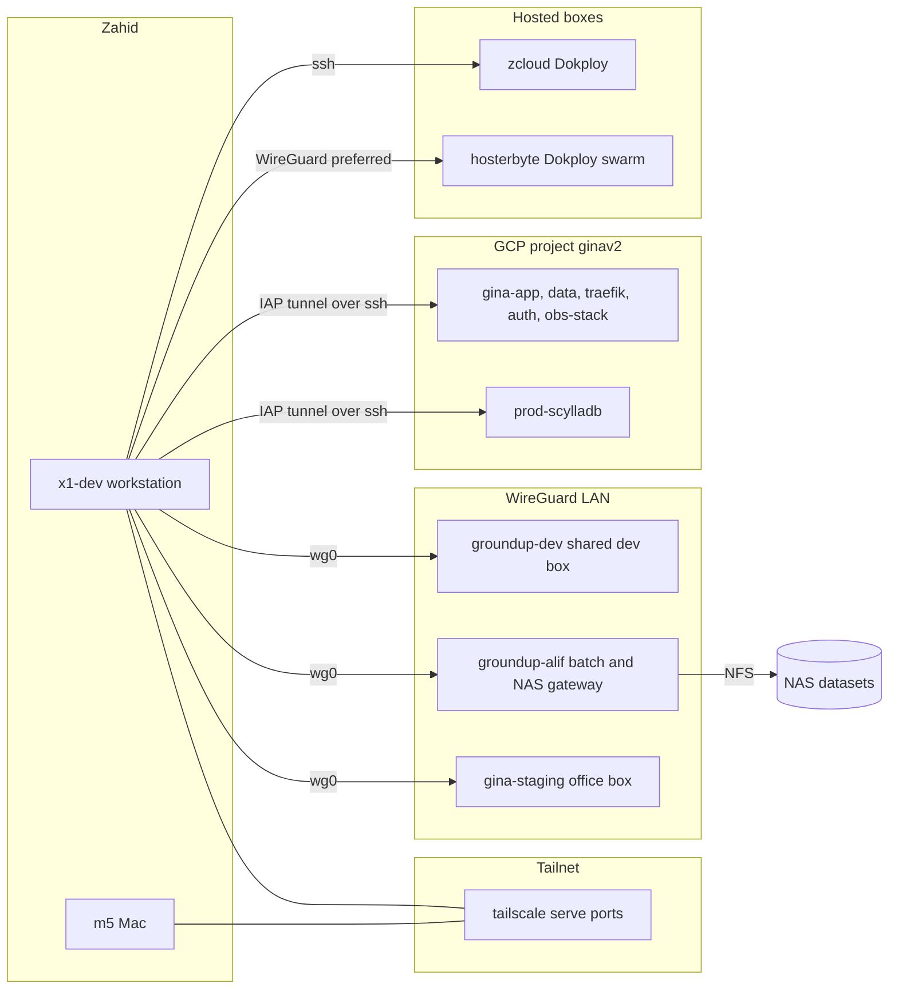

# Reference digest: agent setup, devkit and remote servers

Summary. This digest covers three talk topics. Topic 1 is the agent setup (omp harness, model roles with fallback routing, Tern with the tern-worktrees plugin, herdr, extensions). Topic 10 is the devkit idea for other repos (alkhidmah `packages/devkit`, GinaV2 `develop.sh` and `setup-ginav2.sh`, one shared env file, per-worktree ports and database tiers). Topic 11 is the machine map (x1-dev, m5, groundup-dev, groundup-alif, gina-staging, GCP prod through IAP, tailnet, WireGuard). Snapshot date of the machine state is 2026-11-05. Items marked [UNVERIFIED] or [INFERENCE] come from the research notes and were not re-checked.

Evidence paths are relative to the home directory unless noted. `MS/` means `~/.omp/agent/managed-skills/`.

---

## 1. Agent setup

### Key facts

- omp is the agent harness. Its live home is `~/.omp/agent/`. It holds `config.yml`, `models.yml`, `AGENTS.md`, `mesh.json`, `mcp.json`, `lsp.json`, plus `agents/`, `commands/`, `extensions/`, `managed-skills/`, `skills/`, `rules/`, `sessions/` (`~/.omp/agent/`).
- Sessions are JSONL files grouped by working directory, for example `~/.omp/agent/sessions/-work-talks/`. The archive holds 2,585 sessions across 500+ projects (`local://talk-extra-facts.md`, archive numbers).
- Telemetry in `~/.omp/stats.db` covers 2026-03-07 to 2026-10-21. It records 9,817 sessions, 682,512 model requests and about 116B tokens. The API-equivalent price is $19.9k. That is not actual spend, because subscriptions carry most of it. Say "API-equivalent" on stage.
- Top models by recorded API-equivalent cost in that window were glm-5.3 ($7.8k), glm-5.2 ($2.9k) and claude-opus-5-5 ($2.3k) (`~/.omp/stats.db`, table `message_rollup`).
- Model roles live in `~/.omp/agent/config.yml` under `modelRoles`.
  - `default` is claude-opus-5-5 at low thinking.
  - `plan`, `slow` are claude-opus-5-5 at high thinking.
  - `reviewer` is claude-opus-5-5 at medium.
  - `advisor`, `designer` are claude-sonnet-5-5 at high.
  - `smol`, `librarian`, `fast` are claude-haiku-5-5.
  - `task` is `"@default"`.
  - `vision` and `image` go to other providers.
- Subagents are tuned separately. `task.agentModelOverrides` pins `scout` and `sonic` to the `@fast` role, and pins `task` and `poteto-agent` to sonnet-5-5 at medium. Isolation is on, with `merge: patch` and `commits: ai` (`~/.omp/agent/config.yml`, `task:` block).
- Fallback routing is config, not luck. `retry.fallbackChains` maps a model to a backup, for example haiku-5-5 to the same model on a second provider. The image role has a longer chain (`~/.omp/agent/config.yml`, `retry.fallbackChains`).
- Usage-aware fallback is on: `usageAwareFallback: true`, `usageReservePct: 15`, `waitForUsageReset: true`. Two Anthropic accounts (work and personal) each keep a 5% reserve in `auth.accountPolicies`. Emails are in that file. Never show it unfiltered.
- A preset overlay (`modelPresets`, key name contains a typo) drops plan and slow to low thinking when quota is tight (`~/.omp/agent/config.yml`).
- Compaction tries `snapcompact`, then `remote`, then `soft`, with a 70% threshold and idle compaction after 60 seconds (`~/.omp/agent/config.yml`, `compaction:`).
- Tern is the terminal app. The `tern-worktrees` plugin (id `tern-worktrees`, version 0.3.2) lives at `~/work/labs/tern-worktrees/` and is registered by a one-line pointer file at `~/.config/tern/plugins/tern-worktrees.path`.
- The plugin has three parts (`~/work/labs/tern-worktrees/README.md:1-12`).
  1. The Tern plugin. `cmd+shift+w` opens a branch picker. Closing a worktree tab offers keep or tear down.
  2. The `tern-wt` CLI, "the one implementation of each git and GitHub step".
  3. The `tern-worktrees` omp skill, "the contract that agents follow".
- `tern-wt` is a small sh wrapper at `~/.local/bin/tern-wt` that runs a Bun entry point. Commands are `create`, `remove`, `list`, `branches`, `resolve`, `repos`, `clone`, `new-repo`, `config`, `setup`. Each prints one JSON object, with stable error codes such as `dirty_worktree` and `path_conflict` (`~/work/labs/tern-worktrees/skills/tern-worktrees/SKILL.md`, Commands and Error codes).
- Worktree root is `$TERN_WT_HOME/worktrees`, else omp's `worktree.base` (`~/.omp/wt` here), else `~/.tern-wt/worktrees`. Path layout is `<root>/<repo>/<slug>`, slug is the branch name with `/` turned into `-` (same SKILL.md).
- Default teardown policy is `worktree+merged-branch`. With `worktree.clone: true`, `create` makes a copy-on-write clone of the main checkout, so `.env` and `node_modules` come along (same SKILL.md, "create" and "Options file").
- Orca is the predecessor. Three `orca-*.ts` extensions still sit in `~/.omp/agent/extensions/`, and the Tern skill says it "Replaces Orca worktrees". [INFERENCE] The Orca session log shows the Tern install in Oct 2026 (`~/.config/orca/ai-vault/session-parse-cache.json`).
- herdr is the terminal multiplexer for agent panes. The GinaV2 path creates a tied worktree and workspace in one command: `herdr --session groundup worktree create --cwd <primary> --branch <name> --base main --label <label> --focus --json`. A post-create hook runs the repo bootstrap asynchronously (`MS/groundup-ops/playbooks/ginav2-worktree-and-herdr-workspace.md`, Steps 2 and 3).
- Rule from that playbook: never use `herdr workspace create --cwd` for feature checkouts, because it leaves the workspace untied from the worktree.
- Live extensions in `~/.omp/agent/extensions/` are `poteto-mode.ts`, `herdr-omp-agent-state.ts` and the three `orca-*.ts` files. `autoskills.ts.disabled` and `attention-span-style.ts.disabled` are switched off by renaming.
- Auto-selected skills were tried and turned off. The config caps injection at one skill with no keywords, an empty `autoskills.off` file exists, and the extension is renamed (`~/.omp/agent/autoskills.json`). [INFERENCE] The reading is "explicit routing beats auto-selection". Confirm with Zahid.
- Skill discovery was narrowed on 2026-08-31. Claude skill discovery has priority 80 and `~/.agents/skills` has priority 70, so same-named skills resolved to the wrong copy. The fix sets `enableClaudeUser: false` and `enableClaudeProject: false` (`MS/omp-ops/references/omp-skill-source-binding.md`).
- Two config copies exist. `~/dotfiles/omp/agent/config.yml` is an older copy of the live file. The omp-ops playbook says the live file is a symlink to dotfiles, but the two differ now. [INFERENCE] The symlink was replaced. Run `ls -l` before showing it.
- The Claude marketplace plugin cache holds plugins such as `security-guidance`, `pr-review-toolkit` and `skill-creator`. The marketplace was added 2026-07-30 (`~/.omp/marketplaces.json`).
- Dormant, do not present as current: the Luvus and moshi phone stack ("disabled 2026-09-17") and the `luvus-*` skills parked in `~/.omp/agent/managed-skills-disabled/`.

### Config evolution story (date-tagged `.bak` files)

Every config change gets a snapshot first. The file names carry the date and the reason. Read in order, they are a changelog (`~/.omp/agent/`, and `~/dotfiles/omp/agent/` for the dotfiles ones).

| Date | Backup file | What changed |
| --- | --- | --- |
| 2026-08-26 | `models.yml.bak-pre-zai-glm-flash-20260826`, `config.yml.bak-pre-glm-flash-20260826` | Added GLM flash models |
| 2026-08-31 | `config.yml.bak-disable-claude-skills` (undated, matched to this date by the fix note) | Claude skill discovery off |
| 2026-09-13 | `agent.db.bak-20260913` | Agent database snapshot |
| 2026-09-14 | `models.yml.bak-pre-ds41-20260914-222809` | DeepSeek 4.1 provider edits |
| 2026-09-15 | `models.yml.bak-pre-cline-thinking-20260915` (dotfiles) | Cline thinking provider edits |
| 2026-09-18 | `config.yml.bak-pre-hindsight-20260918` | Memory backend moved to Hindsight |
| 2026-10-04 | `config.yml.bak-pre-2rail-20261004`, `models.db.bak-20261004` | Two-account ("2rail") auth setup |
| 2026-10-25 | `config.yml.bak-pre-cc-deepseek-20261025` | Claude Code and DeepSeek routing |

Undated tags add more steps: `pre-trim`, `pre-task-prewalk`, `pre-research-routing`, `pre-auto-thinking`, `bak-pstack`, `pre-muse-wonder-contrib`, and `bak.crof-fix` in dotfiles.

- Pace. Model routing changed roughly every two to four weeks (`ls ~/.omp/agent/ | grep bak`).
- Caveat on the Hindsight date. The backup says 2026-09-18, but the setup playbook dates the Mnemopi-to-Hindsight data migration 2026-06-28 (`MS/omp-ops/playbooks/omp-hindsight-memory-backend.md`). The two dates conflict. Use the backup date for the config switch and do not quote the migration date unless checked.

### Story/example

The pattern is "snapshot, edit, verify, keep the snapshot". On 2026-10-04 the config gained a second Anthropic account with a 5% reserve per account, so a quota wall on one account falls through to the other instead of stopping a long run. Three weeks later, on 2026-10-25, routing changed again for Claude Code and DeepSeek. Each step left a `.bak` file named after its reason, so a bad day is undone by copying one file back. The same habit applies to the memory backend. The old Mnemopi data was never touched, and rollback is flipping `memory.backend` back (`MS/omp-ops/playbooks/omp-hindsight-memory-backend.md`).

### Show on screen

- `ls ~/.omp/agent/ | grep bak` (the date-tagged story, safe).
- `~/.omp/agent/config.yml`, only the `modelRoles` and `retry.fallbackChains` blocks. Do not scroll to `hindsight.apiToken` or `auth.accountPolicies`.
- `~/work/labs/tern-worktrees/plugin.toml` (four lines) and `~/.config/tern/plugins/tern-worktrees.path`. Do not open anything else in `~/.config/tern/`.
- `tern-wt config` and `tern-wt list --all` (each prints one JSON object).
- `herdr --session groundup worktree list --json`.
- `ls ~/.omp/agent/extensions/` (shows live and renamed-off extensions).

### Quotable

```
description = "Opens git worktrees as Tern tabs, and creates, relocates and tears them down."
```
(`~/work/labs/tern-worktrees/plugin.toml`)

```
- Use `tern-wt` for worktrees, not `git worktree` or `orca worktree`.
- Run `remove` only on a worktree you created in this session, or one the user names.
- Pass `remove --force` only after the user says yes: it discards uncommitted work.
```
(`~/work/labs/tern-worktrees/skills/tern-worktrees/SKILL.md`, Rules)

```
Claude Code is 80; Agent Dirs (`.agents`) is 70. Same skill name: Claude wins.
```
(`MS/omp-ops/references/omp-skill-source-binding.md`)

```
**Do not** use `herdr workspace create --cwd` for feature checkouts. That only
registers a cwd and leaves the workspace untied.
```
(`MS/groundup-ops/playbooks/ginav2-worktree-and-herdr-workspace.md`, quote lightly edited to drop a dash)

---

## 10. Devkit for other repos

### Key facts

- There are two devkits, one per product repo. Both follow one idea. One command takes a fresh clone or fresh worktree to a running stack, with ports, database and env isolated per worktree.
- alkhidmah ships `@alkhidmah/devkit` at `~/work/alkhidmah/main_digital-platform/packages/devkit/` (README, `src/commands/up.ts`, `worktrees.ts`, `db.ts`, `src/lib/ports.ts`). The bin is `alkhidmah`. The root script `bun run bootstrap` equals `alkhidmah up`.
- `alkhidmah up` runs preflight checks, `mise trust`, `bun install`, env generation, Postgres start, schema apply and seed (`packages/devkit/README.md`, Quick Start). Gotcha from the skill copy: `alkhidmah up` reseeds destructively on every run (`MS/alkhidmah-ops/references/alkhidmah-unified-dev-tooling.md`).
- Database tiers per worktree (`packages/devkit/README.md`, Worktree Model).
  - Tier 0 shares the main Postgres. This is the default.
  - Tier 1, `--fork`, makes a branch database named `alkhidmah_<slug>`.
  - Tier 2, `--isolated`, starts its own container on a port in 9900 to 9999 derived from a crc32 of the slug.
- Port allocation is arithmetic, not hand picking. Bind triples start at 29100 plus 3 per index, serve triples start at 8480 plus 3 per index, and the main checkout has pinned ports (same README).
- Isolated worktrees get a cookie prefix `alkhidmah_<slug>` so sessions do not collide on a shared tailnet host. `alkhidmah env` refuses to downgrade from tailnet to localhost unless `--force-local`.
- `alkhidmah identity` and `alkhidmah worktrees` print the slot table for every checkout.
- `prod-init` is a dry run unless `--apply` is passed, and the real database also needs `--allow-main`. Passwords are masked in its output (same README).
- GinaV2 bootstrap has three parts on disk. `develop.sh` is a menu-driven compose orchestrator in the repo root. `~/work/groundup/setup-ginav2.sh` is a machine-local patch script. `~/work/groundup/.env.ginav2` is the shared env file (all three confirmed on disk).
- Shared env model. Every checkout's `.env` is a symlink to `~/work/groundup/.env.ginav2`. An edit changes every checkout, so back it up first (`MS/groundup-ops/references/ginav2-tailnet-dev-stack.md`, Environment model).
- `setup-ginav2.sh` runs once per worktree. It hardlinks datasets with `rsync --link-dest` and re-applies machine-local compose edits (SELinux volume labels, `UV_FROZEN`, per-user external volumes). Those compose diffs are never committed (`MS/groundup-ops/playbooks/gina-shared-datasets-link.md`, `ginav2-frontend-worktree-edit-and-build.md`).
- Compose project name is `${USER}-ginav2`. Volumes are external `${USER}-*-data`. Overriding `USER` forks a second project (`ginav2-tailnet-dev-stack.md`).
- Compose is split in layers. Data, then auth, then traefik, then app, plus a dev overlay (`MS/groundup-ops/references/ginav2-ops-docs-review-sync.md`).
- Per-worktree ports for GinaV2 are a fixed group where host port equals serve port, 8770 to 8776 for client, owner, API, authentik, public API, MinIO and redirector. Containers bind loopback only so `tailscale serve` owns the tailnet side (`ginav2-tailnet-dev-stack.md`, Ports).
- Known trap. A stack whose compose project lists files from two worktrees runs the wrong schema and fails with `SCHEMA CONTRACT CHECK FAILED`. Fix by tearing down and relaunching from one worktree (same reference, Traps).
- End-to-end worktree setup for GinaV2 is herdr worktree create, wait for the async setup hook, verify `Frontend/node_modules`, `.venv` and `database/data/datasets`, then check `worktree list` against `git worktree list` (`ginav2-worktree-and-herdr-workspace.md`, Steps 2 to 5).
- The `gina` CLI (`Devkit/`, distribution `gina-devkit`, Typer) is described in skills as a replacement for the old bash scripts, delivered on branch `perf/rewrite-.sh-script` as draft PR #619. [UNVERIFIED] `Devkit/` did not resolve on the main checkout on disk. Confirm the branch before demoing `gina --json dev up`.
- Skill-documented output contract for `gina`. A terminal gets Rich tables, a pipe gets TOON, and `--json` goes before the subcommand. Exit 1 is runtime error and 2 is usage error (`MS/groundup-ops/references/ginav2-devkit-conventions.md`). [UNVERIFIED] on disk.

### Story/example

The agent never configures a stack by hand. When a task needs a running GinaV2, the agent creates a worktree through herdr, the hook runs the bootstrap, and the shared `.env` symlink means credentials never get copied into a new checkout. The ports are fixed by group, so the agent knows where the client and API will answer before it starts. alkhidmah solved the same problem with arithmetic. The slug picks the ports and the database tier, so two worktrees never fight over 5432. The cost shows in the traps list. One compose project built from two worktrees runs the wrong schema, and the schema check catches it with a loud failure instead of silent drift.

### Show on screen

- `ls -l ~/work/groundup/GinaV2/.env` (shows the symlink to the shared file, not its contents).
- `~/work/groundup/setup-ginav2.sh` header only.
- `./develop.sh` menu, "Run Services", then "All Services".
- `docker compose ls` on the workstation (shows `${USER}-ginav2` project names).
- `bun run bootstrap` in a fresh alkhidmah worktree, then `alkhidmah worktrees`.
- `packages/devkit/README.md`, "Worktree Model" section.
- `alkhidmah prod-init build` without `--apply`, to show a dry-run table. Never pass `--apply`.

### Quotable

```
From a fresh clone (or a fresh worktree): bun run bootstrap
This runs preflight checks, mise trust, bun install, generates .env files,
starts Postgres, applies the schema, seeds the database. One command to developing.
```
(`packages/devkit/README.md`, Quick Start, arrows replaced by commas)

```
One shared env file, ~/work/groundup/.env.ginav2, symlinked as .env by the primary
checkout and by every worktree. Editing it changes all checkouts, so back it up first.
develop.sh sets COMPOSE_PROJECT_NAME="${USER}-ginav2" ... Never override USER for compose.
```
(`MS/groundup-ops/references/ginav2-tailnet-dev-stack.md`)

```
Every subcommand is a dry run without `--apply` and needs `--allow-main`
to apply to the database `alkhidmah`.
```
(`packages/devkit/README.md`, prod-init)

---

## 11. Remote servers

### Machine map



### Key facts

- `~/.ssh/config` defines about 27 host aliases. Agents use plain `ssh <alias>`. Never `cat` the file on stage, because it lists key paths and addresses. Use `grep '^Host ' ~/.ssh/config`.
- x1-dev is the Linux workstation and the tailnet node. It runs the local GinaV2 dev stack, the herdr sessions and the Paseo daemon, and publishes review pages through `tailscale serve` (`MS/infra-ops/playbooks/setup-paseo-omp-daemon.md`, `MS/groundup-ops/references/ginav2-tailnet-dev-stack.md`).
- x1-dev is shared by many agents and two CI runners. A rule fires when test commands appear, telling agents to cap memory and check free RAM first, after an uncapped pytest run reached 38 GB resident (`~/.omp/agent/rules/pytest-resource-cap.md`, `local://talk-extra-facts.md`, Rules that fired live).
- m5 is the Mac. It is the review and browser device, reached over the tailnet. A playbook pulls files from it (`MS/worktree-herdr/playbooks/pull-file-from-m5-mac.md`).
- groundup-dev is the shared GroundUp dev box. It is a WireGuard peer running Ubuntu, with one compose stack per user. Examples are a feature stack for one PRODU ticket and an `agentic-ginav2` stack under the `agentic` user. Host ports differ per stack, for example client 8150, owner 8151, API 8152 and authentik 8155 for the agentic one (`MS/groundup-ops/playbooks/ginav2-agentic-box-source-sync.md`, `ginav2-agentic-live-verify-and-cron-test.md`).
- groundup-dev is also the build host for GinaV2 registry images, not x1-dev (`MS/groundup-ops/playbooks/ginav2-registry-build-deploy.md`). It does not host the PLO database (`MS/groundup-ops/references/audit-plo-deployed-db-readonly.md`).
- Deploys to groundup-dev rsync scoped source trees, never the full tree. The dataset directory is 24 GB of LFS on the box. Then `nohup docker compose ... up -d --build <services>` runs and the log is polled (`MS/groundup-ops/playbooks/deploy-ginav2-agentic-groundup-dev.md`).
- groundup-alif is the batch and NAS gateway. It mounts the NAS datasets over NFS because the workstation cannot reach the NAS directly. It runs long `scylla-cli` batch pulls (`MS/groundup-ops/references/alif-batch-pull-survival.md`, `MS/groundup-ops/playbooks/groundup-nas-mount.md`).
- groundup-alif lesson. `Linger=no` means logind kills the whole user tree when the last SSH session closes. `nohup`, `setsid`, tmux and screen do not escape it. Fix with `loginctl enable-linger` (`alif-batch-pull-survival.md`).
- gina-staging is the office box. Ingress path is Cloudflare DNS, then the office router, then the box, then an Nginx Proxy Manager container that owns ports 80, 81 and 443, then loopback apps. The `staging` user works under a zero-sudo rule (`MS/groundup-ops/playbooks/deploy-groundup-app-to-gina-staging.md`, `references/diagnose-npm-502-gina-staging.md`).
- Staging deploys are `deploy.sh staging app` after `git pull` on the box. The `origin/staging` branch no longer exists (`MS/groundup-ops/references/ginav2-worktree-and-release-branch-map.md`).
- GinaV2 prod and staging VMs run on GCP in project `ginav2`, region asia-southeast1. Aliases such as `gina-app`, `gina-data`, `gina-traefik`, `gina-auth`, `obs-stack` and their `-staging` twins all use a `gcloud compute start-iap-tunnel` ProxyCommand on port 22 (`~/.ssh/config`). Cloud SQL is a separate managed instance.
- ScyllaDB runs on two GCE hosts, `prod-scylladb` and `prod-scylladb-v2`, with mirror and repoint playbooks in `MS/groundup-ops/playbooks/`.
- Prod access is read-only by default. The pattern is an `ssh -fN -L` tunnel to the database, `default_transaction_read_only=on` and a 5 second statement timeout (`MS/groundup-ops/playbooks/prod-readonly-access-playbook.md`).
- Tailnet and serve. `tailscale serve --bg --https=<P> http://localhost:<P>` publishes a loopback port to the tailnet with HTTPS. Port 443 on x1-dev is already taken, so an explicit port is pinned (`MS/infra-ops/playbooks/serve-scratch-protos-tailnet.md`). On the version in use, `tailscale serve` cannot proxy a non-loopback target, so LAN-only devices are reached with `ssh -L` through x1-dev (`MS/infra-ops/references/reach-lan-router-panel-from-m5.md`).
- WireGuard. The GroundUp LAN (`wg0` on x1-dev) reaches groundup-dev, groundup-alif and gina-staging. Hosterbyte Dokploy boxes are reached over a WireGuard VPN where possible, because fail2ban kept banning the workstation's rotating egress address (`MS/infra-ops/references/hosterbyte-wireguard-vpn.md`, `MS/infra-ops/playbooks/hosterbyte-ssh-fail2ban-recovery.md`).
- Discrepancy to settle before the talk. The `hosterbyte-wg` alias and the WireGuard reference doc disagree on the VPN subnet. [INFERENCE] There are two WireGuard generations. Do not state a subnet on a slide.
- zcloud is the Biznet host running Dokploy-managed WordPress and comms stacks. Edit compose through Dokploy as well, or the next deploy reverts it (`MS/infra-ops/references/zcloud-compose-ops.md`).
- Infra hard rules apply everywhere. Pin image tags, back up before any mutating change, a deploy counts only when the running version is verified, and stop and ask before DNS changes, payments, data deletion or live WhatsApp numbers (`MS/infra-ops/SKILL.md:8-16`).
- Infra skill size. `MS/infra-ops/SKILL.md` routes to about 70 playbooks and 20 references (`local://talk-infra-devkit.md`, summary).
- Gap worth naming. The infra playbooks rely on backup and verify steps. The explicit dry-run default lives in the groundup-ops data scripts, not in infra. [INFERENCE] (`local://talk-infra-devkit.md`, gap 6).

### Story/example

On 2026-10-26 a QA report arrived by WhatsApp and Zahid pasted it into a new omp session. The prompt told the agent to test on the shared box, in his words "ssh on groundup dev and do testing there i have ginav2 repo there you can scaffold and start stack there so later on PR i can have proof screenshot or recording". The agent started a stack on groundup-dev, recorded before and after videos against it, and attached them to GinaV2 PR #804. The shared box exists so proof comes from a real running stack, away from the workstation, which other agents are already loading. One tenant stack per user on that box means a proof run does not disturb anyone else's ports (`local://talk-extra-facts.md`, mobile fix story).

### Show on screen

- `grep '^Host ' ~/.ssh/config` (names only).
- `ssh groundup-dev 'docker ps --format "{{.Names}}" | sort'` (shows the per-user stacks, names only).
- `ssh groundup-alif 'df -h /mnt/Datasets'` (the NAS seen through the gateway).
- `tailscale status` on x1-dev. Mask peer names if sharing a screen.
- `~/.omp/agent/managed-skills/infra-ops/SKILL.md` lines 8 to 16 (hard rules).
- The mermaid diagram above, as the opening slide for this topic.

### Quotable

```
- Pin image tags. Never `:latest` (exception: `hindsight-rocm-gpu`).
- Back up before any mutating change to a live service, DB or DNS record.
- A deploy is done only when the running version is verified, not when the job is green.
- Stop and ask before DNS changes, payment actions, data deletion or live WhatsApp numbers.
```
(`MS/infra-ops/SKILL.md`, Hard rules)

```
Owner rule: prod is read-only by default; no writes without explicit approval;
show the plan before running anything heavy.
```
(`MS/groundup-ops/playbooks/prod-readonly-access-playbook.md`)

```
Long scylla-cli pulls die on groundup-alif/dev because both run Linger=no: when the
last SSH session closes, logind SIGTERMs the whole user tree. nohup, setsid, tmux,
and screen do NOT escape it.
```
(`MS/groundup-ops/references/alif-batch-pull-survival.md`)

```
`application.deploy` is an acceptance receipt, not a rollout receipt.
A rolled-back or refused update still shows green while the old container serves.
```
(`MS/infra-ops/playbooks/dokploy-version-gated-deploy.md`)

---

## Do not show

- `~/.omp/agent/config.yml` unfiltered. The memory token is a plain value there and in the git-tracked dotfiles copy. It is a rotation item.
- `~/.ssh/config`, `~/.config/tern/` contents, `~/.omp/agent/secret-placeholder.key`, `~/.omp/agent/org-accounts.yml`, `~/.omp/agent/agent.db`.
- Prompt history in raw form. It contains pasted credentials from client work, and obfuscation does not cover local history (`local://talk-extra-facts.md`, security findings).
