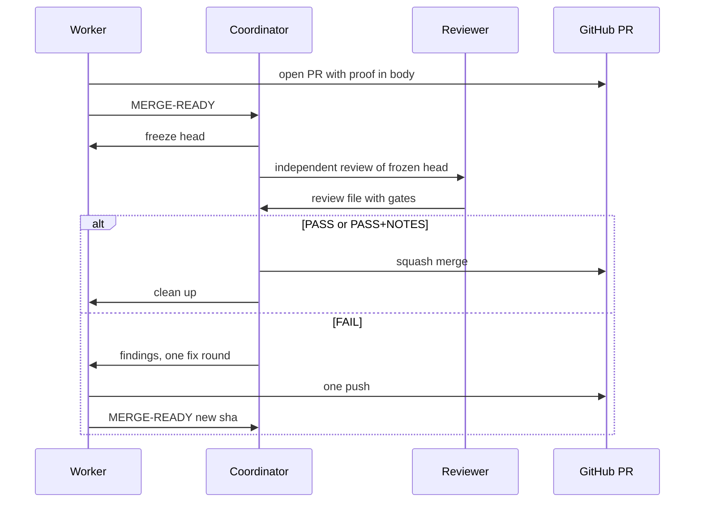
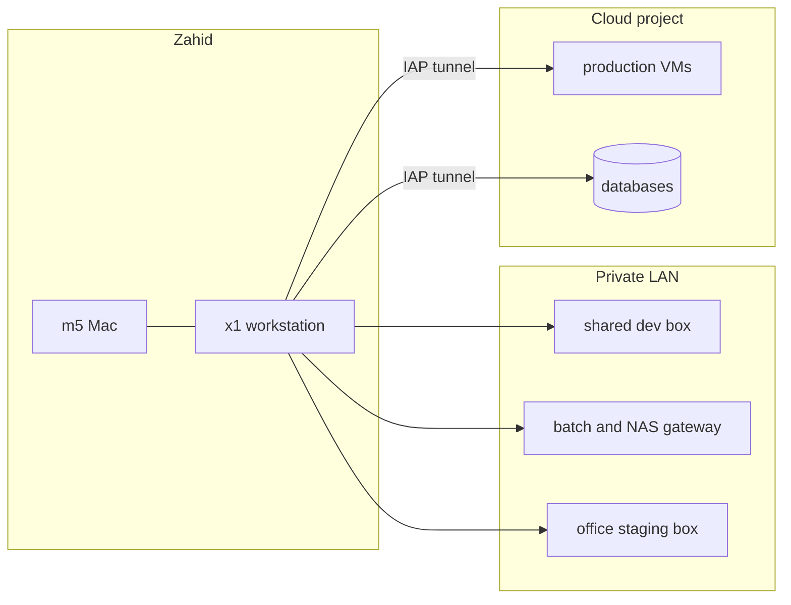

# Benchmarking My Coding Agent Setup: One Engineer, Many Agents
## Detailed outline, self-reading deck

**SWE Growth community. Talk of 90 minutes, online on Zoom. All slides in English.**
**Speaker: Zahid**

## How to use this outline
- This deck is for reading after the talk. Each slide stands alone, uses full sentences, and ends with source pointers.
- The deck follows the same arc and the same timings as the live talk. The run of show below shows the talk window each part belongs to.
- Dollar figures are API-equivalent. That means the list price of the tokens, not money paid. Actual spend is about $200 a month.
- Source pointers name a file in `references/` and the section inside it. The numbers for usage, cost and speed come from `omp stats`, re-aggregated on 2026-11-05 (11,842 sessions, 833,553 model requests, 138B tokens from 2026-03-07 to 2026-11-05).
- No secret values, hosts, emails or customer names appear in this deck. Customers are described in general terms only.

## Claim
The model is a swappable part. What lets one engineer ship from a phone is the setup around it: skills, proof, coordination, and guardrails.

## Run of show and slide map

| Talk window | Part | Deck slides | Organizer questions |
|---|---|---|---|
| 0 to 5 min | Cold open | 1 to 3 | none |
| 5 to 15 min | The journey | 4 to 6 | 1 |
| 15 to 30 min | Pillar 1, the benchmark lab. Live demo starts at about minute 15 | 7 to 16 | 2, 3, 11 |
| 30 to 45 min | Pillar 2, knowledge | 17 to 21 | 5, 7, 8 |
| 45 to 65 min | Pillar 3, the crew. Demo PR is checked at about minute 60 | 22 to 30 | 4, 6, 9 |
| 65 to 75 min | Infra and guardrails | 31 to 34 | 10 |
| 75 to 82 min | Open problems | 35 | 12 |
| 82 to 90 min | Close and Q&A | 36 to 37 | none |

The live talk is rehearsed to about 72 minutes of material. The rest of the 90 minutes is the demo, slack, and 6 minutes of Q&A.

## Coverage of the 12 organizer questions

| # | Question | Slides |
|---|---|---|
| 1 | Tool evolution and why each switch | 4, 5, 6 |
| 2 | Model routing per role | 8, 10 |
| 3 | Effort and thinking level | 8, 11 |
| 4 | Orchestration and parallel agents | 22, 23, 24, 26, 28 |
| 5 | Task and spec management, beads | 21 |
| 6 | Long-horizon runs and guardrails | 24, 27, 28 |
| 7 | Memory and context | 17, 20 |
| 8 | Own skills, favorites | 17, 18, 19, 25 |
| 9 | Review and quality gate, manual checks | 25, 29, 30, 35 |
| 10 | Supporting infra | 31, 32, 33, 34 |
| 11 | Cost and subscription strategy | 9, 10, 12, 13, 14, 15, 16 |
| 12 | Open problems | 35 |

---

# Part 1. Cold open (talk window 0 to 5 min)

## Slide 1. Benchmarking my coding agent setup
- The talk is about one engineer, many agents, and the setup that makes that possible.
- Speaker is Zahid. He works across many repositories, mostly alone, and measured his own habits over eight months and about 11,800 sessions.
- The audience is mixed developers from the SWE Growth community. Many use Claude Code or Cursor. This deck explains omp, the agent harness used here, from scratch.

**Visual hint:** Title card with the claim as a subtitle.
**Sources:** `README.md` (claim, run of show), `sources/context/brief.md`.

## Slide 2. A phone screenshot at 9:29, and a 65-minute fix
- On Tuesday 27 October 2026 the speaker was on board a plane, before takeoff, working from a phone. The screenshot shows an omp session in chat form with a microphone in the composer. The clock reads 9:29.
- PR #804 fixed a sensor-mapping issue in GinaV2. It opened on 2026-10-26 at 10:00 and was approved at 14:56. On 2026-10-27 at 08:52 QA posted a warning with one additional finding. Clicking a draft sensor opened the edit modal.
- At 09:26 the speaker pasted the finding into the existing session with the words "Fix those own changes proof and update pr". At 09:27 the fix was committed. At 09:29 the agent recorded a "before" clip on the shared dev stack and wrote "That reproduces the issue". It then applied the fix and recorded "after". At 09:30 proofs were uploaded and the branch was pushed. At 09:31 the PR body gained proof for item 6. The speaker told QA to run `gh pr checkout 804` instead of waiting for a staging deploy. At 09:57 QA posted a pass and the finding was marked resolved.
- From QA warning to QA pass took 65 minutes, driven from the phone.

**Visual hint:** The phone screenshot `screenshot-omp-mobile-0929.png`, then the timeline table below it.

| Time (WIB, 2026-10-27) | Event |
|---|---|
| 08:52 | QA posts a warning. Draft sensor click opens the edit modal |
| 09:26 | Finding pasted into the session from the phone |
| 09:29 | "Before" recording. The agent confirms the issue reproduces |
| 09:30 | Fix applied, "after" recording, proofs uploaded, branch pushed |
| 09:31 | PR body updated with proof |
| 09:57 | QA posts a pass. Finding resolved |

**Sources:** `references/referensi-mesh-koordinator-mobile.md`, "Topic 8: omp on the phone", PR #804 timeline and "Story/example". Screenshot `references/screenshot-omp-mobile-0929.png`.

## Slide 3. The claim, and four parts around any model
- The claim is that the model is a swappable part. The setup around it carries the work. That setup has four parts: skills, proof, coordination, and guardrails.
- The deck has three pillars. The engine is the speaker's own benchmark lab and covers model routing, effort, the value formula, a bench, prewalk, cost, and subscriptions. Knowledge covers skills, memory, and specs. The crew covers worktrees, mesh, a coordinator, base-branch coordination, review gates, and PR proof.
- After the pillars come infra and guardrails, then the honest open problems, then one action to take home.
- Outside evidence for the claim. Can Bölük, the author of omp, wrote on X "I improved 15 LLMs at coding in one afternoon. Only the harness changed." (https://x.com/_can1357/status/2021828033640911196)

**Visual hint:** A model box in the center with four boxes around it, and a strip of the three pillars.
**Sources:** `README.md`, "The claim". `sources/context/brief.md`, "What the audience leaves with".

---

# Part 2. The journey (talk window 5 to 15 min)

## Slide 4. What a harness is
- A harness is the program around a model. It gives the model tools, context, memory, and rules. Claude Code, Cursor, OpenCode, Amp, and omp are harnesses. Claude, GPT, and GLM are models.
- The same model behaves very differently in different harnesses. The harness decides which files the model sees, which commands it can run, and what it remembers next time.
- This talk compares setups. It does not rank models.

**Visual hint:** Two-layer diagram, model below and harness above.
**Sources:** `sources/context/brief.md`, "Audience". `references/referensi-setup-dan-infra.md`, "1. Agent setup".

## Slide 5. Tool journey, and why each switch
- Order from the data. Gemini tooling on the Mac (m5) on 2025-07-29. Claude Code on 2025-10-19. OpenCode on 2025-10-20, with 215 sessions on m5. Amp from 2025-12-22 to 2026-03-16. omp on m5 on 2026-02-23 (37 session folders). omp on the x1 workstation, main tool since 2026-03-07. Prompts for oh-my-opencode are concentrated in 2026-03 on x1.
- Antigravity was used briefly at the start while it had good free usage and features such as plan annotations and session artifacts. The speaker left because it is heavy, quality and limits got worse, and the Google account was banned.
- Claude Code was the start. Some tasks were not good enough and the speaker wanted more efficiency, so he moved to oh-my-opencode (OMO) on OpenCode, first as a CLI and then with the OpenChamber web UI. OMO had many issues and limits because it extends OpenCode. Quality was lower. Claude and OpenAI subscriptions were getting banned on OpenCode.
- Amp was more mature and was used the longest. The speaker mostly used a proxy (CLIProxyAPI) to get very large usage. Amp had cross-agent communication and could spawn other agents. The speaker no longer remembers why he left Amp.

**Visual hint:** Timeline bars from July 2025 to November 2026, with a table of "what I liked" and "why I left".

| Tool | What worked | Why it ended |
|---|---|---|
| Antigravity | Free usage, plan annotations, session artifacts | Heavy, quality and limits, account ban |
| Claude Code | Where it started | Some tasks not good enough, wanted efficiency |
| oh-my-opencode on OpenCode | CLI, then OpenChamber web UI | Limits of an extension, quality, subscription bans |
| Amp | Mature, proxy for large usage, cross-agent messages, spawn agents | Forgotten |
| omp | Extensible, own plugins | Current tool |

**Sources:** `README.md`. Speaker's own account of the journey (settled decisions). `references/referensi-setup-dan-infra.md`, "1. Agent setup".

## Slide 6. Why omp
- omp is extensible. The speaker writes his own plugins for the problems he hits. This is the main reason he chose it.
- It also has autolearn (it mints skills from sessions), Hindsight memory, multi-provider subscription logins, and good compaction.
- The live home of omp holds the config, model definitions, a global AGENTS.md, mesh settings, extensions, skills, rules, and session logs as JSONL files grouped by working directory.
- The sections that follow show what that extensibility produced.

**Visual hint:** Five-icon row (plugins, autolearn, memory, logins, compaction). Screenshot of the extensions folder.
**Sources:** `references/referensi-setup-dan-infra.md`, "1. Agent setup", "Key facts".

---

# Part 3. Pillar 1, the benchmark lab (talk window 15 to 30 min)

## Slide 7. Live demo, from the phone
- At about minute 15 of the live talk, a small real issue from the Alkhidmah backlog is sent from the Tern Android app. The phone screen is shared next to the laptop.
- The agent works in its own worktree and aims for a PR with proof in the body. The PR is checked again at about minute 60 (slide 30). A recorded backup exists in case the live run fails.

**Visual hint:** Phone mirror with a Tern session and the prompt in the speaker's loose style.
**Sources:** `README.md`, "Open items". `references/referensi-skills-prompt-dan-config.md`, "Topic 2", "Quotable".

## Slide 8. Model routing per role, and the effort rule
- Each role has a model and an effort level. The default role is Opus at low effort. Plan and slow are Opus at high. The reviewer is Opus at medium. Advisor and designer are Sonnet at high. Task agents run Sonnet at medium. Scout, sonic and the small roles run Haiku, the fast model.
- Effort rule. Low for execution, because it is fast. High for plans and hard debugging. Medium for review. Max almost never, because it is slow and gains little. Effort is not recorded per request in the usage stats. The bench on slides 10 and 11 is the measured evidence for the execution half.
- Routing is configuration. A fallback chain maps a model to a backup on another provider. Usage-aware fallback is on, with a 5% reserve on each of two Anthropic accounts, so a quota wall on one account falls through to the other. Config changes every two to four weeks, and each change leaves a dated backup file.
- Speed since 2026-10-01 on Anthropic models, average per request. Haiku 5.5 as a subagent 6.3 seconds at 130 output tokens per second over 73k requests. Sonnet 5.5 as a subagent 6.1 seconds at 95 over 53k requests. Opus 5.5 as the main model 8.3 seconds at 66 over 52k requests. Time to first token is 1.4 seconds for Haiku and 2.6 for Opus as main.

**Visual hint:** Table of roles with model and effort. Cropped `modelRoles` block. One small speed strip.

| Role | Model | Effort |
|---|---|---|
| default | Opus | low |
| plan, slow | Opus | high |
| reviewer | Opus | medium |
| advisor, designer | Sonnet | high |
| task agents | Sonnet | medium |
| scout, sonic, smol | Haiku | fast |

**Sources:** `references/referensi-setup-dan-infra.md`, "1. Agent setup", "Key facts" and "Config evolution story". `omp stats` re-aggregated on 2026-11-05 (speed table).

## Slide 9. The value formula
- A price per million tokens misleads, because a subscription changes what a token costs. The speaker turns each subscription into an effective price with four lines. The formula catches the case of $25 per 1M against $2 per 1M at the same performance.
- Procedure. Query `~/.omp/stats.db` for 30 days of usage and speed. Pull one common benchmark for every candidate. Get each subscription's quota in dollars per window and its cost. Compute the four numbers, rank them, apply a quality floor, then pick the highest speed-adjusted score above the floor.
- Rules. Use one common benchmark only (Terminal-Bench 2.1), never a mix. Count the accounts, since two accounts of one plan double the quota. `cost_total` in the stats is API-equivalent, not spend. GLM is verbose, and DeepSeek may use 30 to 50 percent fewer tokens for the same work.
- September 2026 example. DeepSeek V4.1-Flash scored 90.6 at about 118 tokens per second. GLM-5.3 scored 88.2 at about 42. The scores are close and GLM loses about 4 times on the speed-adjusted value.

**Visual hint:** The four lines in a code block, then one example row.

```text
Value Multiplier    = Quota $ / Subscription cost
Effective $/1M      = Blended $/1M / Value Multiplier
Value Score         = Benchmark / Effective $/1M
Speed-adjusted QSPD = (Benchmark x tok/s) / (Effective $/1M x 1000)
```

**Sources:** `references/referensi-benchmark-lab.md`, "1. The value formula". Origin files `omp-ops/references/omp-sub-value-ranking.md` and `zahid-ai-subscription-portfolio.md`.

## Slide 10. A bench of my own, October 2026
- Method. A fixed harness. Two easy tasks, a UI page (`index.html`) and a slot finder (`slots.py`). Three runs each, graded by hidden checks. Numbers are medians. Scripts live in `~/.omp/agent/bench/`.
- Every arm passed 126 of 126 checks. The bench does not rank quality. It separates models on speed and cost.
- Opus low was fastest. Haiku medium was the cheapest Claude arm at $0.02 to $0.03 per task, and took about twice as long. DeepSeek was cheap per token and the slowest arm, because it made far more turns. Spark 1.3 contributor at low effort was the cheap-lane sweet spot, about a cent per task on a flat plan.
- Medium effort on Spark and Wonder added time with no measured quality gain. Costs are list price (API-equivalent) per task.

**Visual hint:** The solo arms table with the cost column highlighted.

| Setup | UI | Slot finder | Cost per task (API-equivalent) |
|---|---|---|---|
| Opus 5.5 low | 92 s | 54 s | $0.22 to $0.39 |
| Sonnet 5.5 medium | 94 s | 84 s | $0.17 to $0.24 |
| Spark 1.3 low | 103 s | 71 s | $0.08 to $0.15 |
| Spark 1.3 contributor low | 121 s | 88 s | about $0.01, flat plan |
| Haiku 5.5 medium | 170 s | 120 s | $0.02 to $0.03 |
| Haiku 5.5 high | 207 s | 240 s | $0.04 to $0.05 |
| Wonder 1.0 low | 136 s | 252 s | $0.39 to $0.41 |
| DeepSeek v4.1 flash low (CommandCode) | 476 s | 275 s | $0.04 to $0.07 |
| DeepSeek v4.1 flash high (CommandCode) | 661 s | 542 s | not measured |

**Sources:** `references/referensi-benchmark-lab.md`, "2. The October 2026 bench". Origin `omp-ops/references/model-bench-results.md`.

## Slide 11. Higher effort took more turns
- Raising effort raised the turn count in every head-to-head pair. Lower effort gave fewer turns and fewer tokens. The guess that low effort needs more steps is wrong on these tasks.
- The turn counts are measured over three runs per arm. The likely cause is checking. Higher effort re-reads and re-checks, and each check is a turn. The cause is an inference.
- DeepSeek going from low to high effort made it worse on both tasks.
- The rule stays. Low for execution, high for plans and hard debugging, medium for review, max almost never. The bench covers execution on easy tasks. The "high for plans" half is the speaker's judgment.

**Visual hint:** Paired bars for each row of the table.

| Model | Task | Lower effort turns | Higher effort turns |
|---|---|---|---|
| Haiku 5.5 | slot finder | 12 (medium) | 16 (high) |
| Haiku 5.5 | UI | 15 (medium) | 16 (high) |
| Spark plain | slot finder | 9 (low) | 23 (medium) |
| Spark plain | UI | 17 (low) | 23 (medium) |
| Spark contributor | slot finder | 9 (low) | 20 (medium) |
| Spark contributor | UI | 19 (low) | 22 (medium) |
| Sonnet 5.5 | slot finder | 4 (low) | 5 (medium) |
| Sonnet 5.5 | UI | 7 (low) | 10 (medium) |
| DeepSeek flash | slot finder | 22 (low) | 40 (high) |
| DeepSeek flash | UI | 28 (low) | 40 (high) |

**Sources:** `references/referensi-benchmark-lab.md`, "3. Effort versus turns". Origin `omp-ops/references/model-bench-results.md`, "Effort versus turn count".

## Slide 12. Handoff arms, and what the bench cannot say
- Handoff arms. Opus low to Sonnet medium took 136 s and 84 s at $0.35 to $0.48 per task. Sonnet medium to Haiku medium took 157 s and 127 s at $0.17 to $0.36. On short tasks a handoff costs extra, because the second model re-reads the conversation after the switch.
- Real long sessions showed the reverse. At 50 or more turns, Sonnet medium alone cost $2.58 per task and Sonnet medium to Haiku medium cost $1.63, at about the same time. These are estimates from logs of uncontrolled work, not graded results.
- The lesson. Every arm passed, so speed and cost separate the models on easy tasks.
- Caveat. The bench is two easy tasks. Public Terminal-Bench 4.0 puts Haiku 5.5 at 39.2% and Sonnet 5.5 at 70.6%, and Anthropic says Haiku can report a change as done without running a check at low or medium effort. Haiku on long multi-step work is unproven. Do not compare these 4.0 figures with the Terminal-Bench 2.1 scores on slide 9.

**Visual hint:** The two handoff rows next to the solo rows they came from. A warning card, "easy tasks, 3 runs, hidden checks, not a quality ranking".
**Sources:** `references/referensi-benchmark-lab.md`, "4. Handoff arms, the lesson, and the Terminal-Bench caveat".

## Slide 13. Prewalk, and why reading is the cost
- What it is, from the omp docs. Prewalk is a one-shot handoff from the active model to a faster or cheaper model after planning reaches implementation. The starting model inspects the repository, writes a todo list and begins the change. Then the target model continues the session.
- How it fires. An armed prewalk injects a planning nudge. A successful `todo` call opens the gate. At the first `edit` or `write` the session switches to the target (default the `@smol` role), drops the planning instruction and steers with an implementation checklist. It is off by default. Flags are `--prewalk`, `--prewalk-into <model>` and `/prewalk`. Subagents use `task.agentPrewalk`.
- The idea comes from Can Bölük, the omp author at Stencil, "You only need the frontier model for one single edit" (2026-07-13). "Opus fixing things does not cost money. Opus reading things costs money." In his token data only 9% of 1.81B tokens across about 2M tool calls were edits.
- A plain /plan handoff fails for that reason. Opus plans read-only and Flash implements, which cost $3.18 per task, 12.7 minutes, 84.6% pass. Opus alone cost $2.78, 10.1 minutes, 84.6%. The cheap model re-reads the code, so reading is paid twice. "Hand off a trajectory, not a fairytale."

**Visual hint:** Two quote cards ("Opus reading things costs money." and "Hand off a trajectory, not a fairytale.") and a four-step line (plan, todo, first edit, swap).
**Sources:** `references/referensi-benchmark-lab.md`, "6. Prewalk". omp docs `omp://prewalk.md`. https://stencil.so/blog/prewalk

## Slide 14. Prewalk receipts, and why mine is off
- The author's receipts on SWE-Bench Pro. GPT-5.6 Sol prewalk into Luna reached 85% pass at $1.04 and 300 s. Sol alone reached 88% at $1.71 and 372 s ("97% of Sol's pass rate at 61% of the cost"). Opus 4.8 prewalk into Flash reached 78% at $1.46. Opus alone reached 85% at $2.78 ("92% of Opus at 53% of the cost, 1.5x the speed"). These are the author's numbers, not the speaker's.
- The speaker's own experience. He used prewalk before. It took extra time on some tasks. A Haiku target was too expensive at the time, and a DeepSeek target was too slow. DeepSeek flash was also the slowest arm in his bench at 476 s on the UI task. It is off now.
- His framing. Plan with the strong model and execute with the cheap one. It pays off on long sessions and costs more on short tasks. Test it on your own workload.

**Visual hint:** The receipts table below, with the Sol row highlighted, and a card "Zahid, prewalk, off now".

| Arm | Pass | Cost per task | Time |
|---|---|---|---|
| GPT 5.6 Luna alone | 77% | $0.60 | 570 s |
| GPT 5.6 Sol prewalk into Luna | 85% | $1.04 | 300 s |
| GPT 5.6 Sol alone | 88% | $1.71 | 372 s |
| Gemini Flash 3.5 alone | 60% | $1.16 | 360 s |
| Opus 4.8 prewalk into Flash | 78% | $1.46 | 402 s |
| Opus 4.8 alone | 85% | $2.78 | 606 s |

**Sources:** `references/referensi-benchmark-lab.md`, "6. Prewalk". https://stencil.so/blog/prewalk. Speaker's own account.

## Slide 15. Cost, October 2026
- October 2026 was 270k requests and 41B tokens. The API-equivalent price was $7.3k. The speaker paid about $200, roughly 36 times less. The all-time figure from 2026-03-07 to 2026-11-05 is $25.9k API-equivalent over 833,553 requests.
- 97% of tokens in October were cache reads. Without prompt caching the same work would price at $58.2k for the month and $158.7k over all time. Two thirds of October requests (66%) came from subagents. 277 distinct project or worktree folders were active.
- Growth by month. Requests were 36k in March, 23k in June, 46k in July, 174k in August, 235k in September, and 270k in October. 47k requests were made from 1 to 5 November.

**Visual hint:** One big comparison of "$7.3k API-equivalent" and "about $200 paid". Bar chart of requests per month.

| Month | Requests | Tokens | API-equivalent | Cache-read share |
|---|---|---|---|---|
| 2026-08 | 174k | 25.7B | $5.5k | 96.4% |
| 2026-09 | 235k | 50.2B | $6.6k | 96.7% |
| 2026-10 | 270k | 41.1B | $7.3k | 97.1% |

**Sources:** `omp stats` re-aggregated on 2026-11-05 (per-month table). `references/referensi-setup-dan-infra.md`, "1. Agent setup", first and second key facts.

## Slide 16. The subscription journey, ending in all in on Claude 5.5
- September 2026. GLM Max was the speaker's own, a one-year plan bought cheap at the launch price. Codex Pro came from the office. Devin Pro and OpenCode Go were his own. The `standard-fast` preset used glm-5.3 as the default.
- Over eight months the speaker used at least 12 providers, ranked by requests. Anthropic 240k, zai (GLM) 224k, openai-codex 128k, muse-sub 91k, opencode-go 59k, muse-code 18k, devin 10k, alibaba-coding-plan 9.6k, commandcode 9.3k, xiaomi-token-plan 9.0k, kimi-code 7.3k, github-copilot 5.7k.
- In October 2026 Anthropic carried 187k requests, muse-sub 37k, opencode-go 22k, muse-code 18k, and commandcode 5k. In November so far it is Anthropic only.
- When the Claude 5.5 series arrived, he went all in on Claude. His words, "Claude 5.5 series quality is GOAT". Now 2x Claude Max and OpenCode Go. Spend is usually about $100 a month and is about $200 now because the workload is heavy.

**Visual hint:** Two columns, September and now, with each plan tagged "own" or "office". A small bar chart of requests per provider.
**Sources:** `references/referensi-benchmark-lab.md`, "5. Subscriptions, September 2026 versus now". `omp stats` re-aggregated on 2026-11-05 (providers). Origin `omp-ops/references/zahid-ai-subscription-portfolio.md`.

---

# Part 4. Pillar 2, knowledge (talk window 30 to 45 min)

## Slide 17. Skills and memory do different jobs, and one rule for skills
- In the speaker's words, "Skills and references are for TIL and reusable knowledge, while memory is what you do cross-project." Skills hold how to do a thing. Memory holds what was done and decided across projects.
- The rule for making a skill. "When you see you are doing the same work more than twice, it is a candidate for a skill, so the agent can do it for you." This is the one action the talk asks the audience to take.
- A skill is a folder with a `SKILL.md` that the agent loads when the work matches. It can include playbooks (steps to follow) and references (facts to look up).

**Visual hint:** Two columns for skills and memory, with the skill rule in large type.
**Sources:** `sources/context/brief.md`, "What the audience leaves with". `references/referensi-skills-prompt-dan-config.md`, "Topic 3b".

## Slide 18. Area skills, one per domain, kept tidy by a lint
- There are 14 area skills, one folder per domain. They are alkhidmah-ops, alumni-ops, astronvim-ops, career-ops, comms-ops, eng-toolkit, git-pr-workflow, groundup-ops, infra-ops, nimbly-ops, omp-ops, thesis-ops, warga-ai, and worktree-herdr.
- Each `SKILL.md` is only a router. Playbooks are step lists to follow. References are facts to look up. Every file must be linked from the router with one line. A task reads one router and then one playbook or reference, so unrelated work stays out of its context.
- A lint script, `skills_lint.py`, enforces the layout. It checks that `SKILL.md` exists, the name matches the folder, the description is at most 1024 characters, there are no extra frontmatter keys, `SKILL.md` is at most 500 lines, there are no nested directories, every file is linked, and every mentioned path exists. It exits with 1 on errors. A pre-commit hook runs it.
- The layout rule used to be a longer instruction. It became a script, so the check no longer depends on anyone remembering it.

**Visual hint:** Folder tree of one area skill. Terminal screenshot of the lint summary line (run before the talk and keep the output).
**Sources:** `references/referensi-skills-prompt-dan-config.md`, "Topic 3b: area skills per domain, and the lint".

## Slide 19. Autolearn story
- Autolearn mints skills from sessions. The speaker first turned it on automatically. It minted too many skills.
- He consolidated them into 14 domain skills and added the lint from the previous slide.
- Now he triggers autolearn by hand after a session that taught something. The live config has `autolearn` enabled with `autoContinue` off, so it does not chain into more work by itself.

**Visual hint:** Three steps. Many skills, then 14 domain skills with a lint, then a manual trigger.
**Sources:** `references/referensi-skills-prompt-dan-config.md`, "Topic 3c", "Key facts: autolearn". Speaker's own account.

## Slide 20. Memory journey, context, and compaction
- Memory went from Mnemopi to Hindsight on 2026-06-28. Cognee was tried in September 2026 and destroyed on 2026-10-19. Hindsight stays.
- The config uses `retainMode: last-turn`, `retainEveryNTurns: 10`, `retainOverlapTurns: 2`. Retaining after every run is the most expensive option, because each retain runs a model extraction. Retaining every 10 turns is the budget setting. The old Mnemopi data was never touched, so rollback is one config change.
- Compaction tries snapcompact, then remote, then soft. It starts at 70% of the context window and also runs when idle after 60 seconds.
- Good compaction plus the memory layer is why the speaker dropped explicit task tracking (next slide).

**Visual hint:** Three-stage memory timeline. Config snippet. Small compaction flow.
**Sources:** `references/referensi-skills-prompt-dan-config.md`, "Topic 3c: memory with Hindsight". `references/referensi-setup-dan-infra.md`, "1. Agent setup" (compaction).

## Slide 21. Specs, layered instructions, and why beads was dropped
- The speaker pastes raw context into the session. Examples are a WhatsApp thread from QA, screenshots, HAR dumps and spreadsheets. The structure is in the rules and skills around the prompt, not in the prompt.
- Instructions are layered. A short global file holds hard rules and the mesh rules. Small rule files fire always or on a regex. Each repo has an AGENTS.md where the nearest file wins, with a size budget that a check enforces.
- When the main agent briefs a subagent, the brief has one shape. A "Complete assignment thoroughly:" opening, then Target, Change, and Contract or Output sections.
- Beads was dropped. Agents got smarter. Beads is not really human-readable. Agents keep context better now with omp compaction (snapcompact) and the memory layer. GitHub issues plus coordinator ledgers replace it.

**Visual hint:** Layer diagram of instructions. Strike-through of "beads" with the replacements next to it.
**Sources:** `references/referensi-skills-prompt-dan-config.md`, "Topic 2: how he organizes and prompts". Speaker's own account of beads.

---

# Part 5. Pillar 3, the crew (talk window 45 to 65 min)

## Slide 22. Worktrees, one per task
- Every task gets its own git worktree, so agents never share a working directory. Worktree path is `<root>/<repo>/<slug>`, and the slug is the branch name with slashes turned into dashes.
- The speaker's plugin `tern-worktrees` (version 0.3.2) has three parts. A Tern plugin opens a branch picker with a shortcut and offers keep or tear down when a worktree tab closes. A CLI named `tern-wt` is the one implementation of each git and GitHub step. A skill is the contract agents follow.
- `tern-wt` prints one JSON object per command and uses stable error codes such as `dirty_worktree` and `path_conflict`. With copy-on-write clone enabled, `create` copies ignored files such as `.env` and `node_modules`.
- Rules in the skill. Use `tern-wt`, not `git worktree`. Remove only a worktree created in this session or named by the user. Use `--force` only after the user says yes.

**Visual hint:** Terminal screenshot of `tern-wt list --all`, no private paths.
**Sources:** `references/referensi-setup-dan-infra.md`, "1. Agent setup", Tern and `tern-wt` facts, "Quotable".

## Slide 23. Custom omp plugins
- The mesh plugin, `omp-agent-mesh`, is the largest. It is an Effect-based engine with repo groups, presence, waking messages, throttled sends, file claims and subagent attribution. It has 7 commits from 25 to 26 October 2026.
- `omp-org-account-router` restricts each session to the GitHub account of the repo's organization. Office account for office repos, personal accounts for personal repos.
- Others. `poteto-mode.ts` autoloads the poteto skill once per context. `tern-worktrees` handles worktrees. `paseo-omp` has 237 commits from September to October 2026. `opencode-go-multi-auth` rotates OpenCode Go keys. `herdr-omp-agent-state.ts` reports agent state to herdr. Older orca extensions remain. `omp-anthropic-sub` and `omp-muse-sub` were subscription routing experiments, and muse was retired on 2026-10-10.
- A skills repo, `omp-skills`, holds the poteto and pstack skills ported to omp, with upstream branches kept untouched.

**Visual hint:** Card grid with mesh as the large card.
**Sources:** `references/referensi-skills-prompt-dan-config.md`, "Topic 3a". `references/referensi-setup-dan-infra.md`, "1. Agent setup", extensions. Plugin list from the speaker's own plugin lock and repos.

## Slide 24. Mesh, and why long runs need one writer per branch
- Many omp sessions share one machine, one set of ports and one Docker daemon. Mesh stops two agents from running the same heavy job or editing the same file.
- The rules are in the global AGENTS.md. Run `peers` before shared work. Keep a `note` current with ports and containers held. Check a port with `ss -ltn` before binding. If a peer shows the same heavy work, send a message and wait. Claim files outside your own worktree and release them when done. Edits to a claimed file are blocked automatically.
- The event log had 10,083 lines on 2026-11-05, and 101 session files used the mesh tool.
- Limits found in long runs. Idle sessions do not wake on mesh messages, and an ended session never sees a broadcast. So each branch gets one writer, and a dead owner is replaced by a fresh one. On 2026-11-02 the coordinator wrote this into its ledger. Subagents and sessions outside the configured roots get `MESH_NOT_JOINED`.

**Visual hint:** Terminal screenshot of `mesh peers`. Quote card with the ledger reason.
**Sources:** `references/referensi-mesh-koordinator-mobile.md`, "Topic 4: omp mesh", "Key facts" and "Story/example".

## Slide 25. The poteto skill set, and the favorite principle
- poteto-mode is an agent style skill from the pstack plugin, MIT licensed. The speaker ported it to omp and keeps a fork. It has 25 principles (11 core, 6 architecture, 5 verification, 2 delegation, 1 meta) and 23 playbooks, such as bug fix, babysit, shipping, orchestrate and autonomous run.
- The skill demands a visible effect. The reply must name each principle that shaped a decision and the choice it changed. An extension loads the skill once per context. The speaker often ends a prompt with the word "poteto".
- The favorite is `principle-check-every-layer`, the speaker's own principle added to poteto. For any design, plan, review or build, it asks for findings on three layers, or one line on why a layer does not apply. The layers are product and the human walk, structure, and data and flow. A rule file loads it on every turn for the main agent, reviewers and task agents.

**Visual hint:** Three stacked layers with an example finding on each.
**Sources:** `references/referensi-skills-prompt-dan-config.md`, "Topic 3a: poteto-mode, pstack, and the principles", "Key facts".

## Slide 26. The SHIP coordinator loop
- A coordinator is an ordinary omp session that drives workers through mesh, `gh`, TSV ledgers and independent reviewer subagents. The SHIP run lasted about three days, from 2 to 5 November, and kept a 276-line ledger. The ledger directory holds 80 files.
- Worker contract. Do not merge. Send `MERGE-READY #<pr> <full sha>` when ready. Freeze the head. An independent reviewer reviews that head. The coordinator relays findings for at most one fix round, and the worker puts everything in one push. Product questions go to the coordinator, not to the human.
- After merge, the worker removes containers and worktree scratch and replies "clean".
- Ledger columns are ts, phase, decision, why, evidence, result.

**Visual hint:** The sequence diagram below.



**Sources:** `references/referensi-mesh-koordinator-mobile.md`, "Topic 7: Coordinator session", including "Diagram: coordinator loop".

## Slide 27. What the ledger shows, in real rows
- PR #488. The coordinator "started fresh owners ... because their sessions had ended and never saw the broadcast", with the reason "idle sessions don't wake on mesh messages; each branch needs one writer".
- PR #490 failed review because the reviewer ran the README command as written in a clean worktree and it errored.
- PR #492 failed because a reviewer proved on a throwaway Postgres that a staging mask left most personal data and that a rerun could drop the only prior live database. The coordinator then decided #492 did not gate the release, because it was a devkit-only CLI and nothing in the production images changed.
- Operator gates stay with the human. The human decides merges of finished work and holds production deploys.
- Every decision is one row with a reason, so a long run can be audited later.

**Visual hint:** Three ledger rows as quote cards, customer names removed.
**Sources:** `references/referensi-mesh-koordinator-mobile.md`, "Real ledger rows" and "Story/example" under Topic 7.

## Slide 28. Base branch coordination, solved by mesh and one coordinator
- Many PRs against one base branch need someone who knows the state of every branch. The speaker solved this with his own mesh plugin, `omp-agent-mesh`, plus one spawned coordinator agent that guides and coordinates the workers.
- One writer per branch. Workers do not merge. The coordinator merges in sequence after an independent review of the frozen head.
- Mesh does not reach subagents or sessions outside its configured roots. When it cannot reach a worker, the coordinator reads the worker's session file and types into its tab, and the loop continues.

**Visual hint:** One coordinator with workers on separate branches. Solid lines for mesh messages, dotted lines for the session-file fallback.
**Sources:** `references/referensi-mesh-koordinator-mobile.md`, "Topic 4: omp mesh", "Key facts", and "Topic 7: Coordinator session".

## Slide 29. Review report and quality gates
- The reviewer freezes a verdict at one commit. One example reads "Frozen verdict: PASS+NOTES at head 592b92ae9".
- A gates table lists the `verify.ts` verdict, which is PROVEN when the proof fails on master and passes on the head at desktop width 1280 and mobile width 390. It also lists merge-tree clean, check-types, the architecture lint baseline, and unit and e2e counts on a throwaway database that is removed afterward.
- Findings are tagged P2 or P3 with confidence, file and line, and a fix.
- Alkhidmah has its own proof gate. A user-facing change needs a written proof, driven red before the change and green after, with a PROVEN verdict and zero console errors.
- What is still checked by hand is UI and visual feel, and UX.

**Visual hint:** Review report header and gates rows, with customer names removed.
**Sources:** `references/referensi-mesh-koordinator-mobile.md`, "Topic 7", review report shape. `references/referensi-pr-proof-security-prod.md`, "1. PR standard and proof".

## Slide 30. PR body shape, proof ladder, and the demo PR check
- A PR body is a briefing, one minute for a reviewer who already has the diff. Sections in order are Why, How, What changed, Scope, Tradeoffs, Blast Radius, and Verification, then a `Ticket:` line. The title is `type(scope): imperative subject`, at most 72 characters.
- Verification has one bullet per claim with proof beside it. It ends with "Not verified:" and a list, or "Not verified: none". The text above the first `<details>` block is about 40 lines, because it becomes the squash commit.
- Proof ladder. Take the first rung that shows the claim. A recording for visible behavior, before and after for a bug. The command and its real output for an API or CLI. The run link and the one output line for CI or infra. The test command and its result when nothing is visible.
- No command called `poteto validate` exists. Proof comes from the Prove It Works principle, which asks for verification against the real artifact, plus this PR shape. Every proof link is one the agent produced or opened in that session.
- At about minute 60 of the live talk, the demo PR is opened and its body is checked against this shape.

**Visual hint:** Seven-section stack, four-rung ladder, and the Verification section of PR #804 with before and after clips.
**Sources:** `references/referensi-pr-proof-security-prod.md`, "1. PR standard and proof", "Key facts" and "Story/example". `references/referensi-mesh-koordinator-mobile.md`, "PR #804 timeline".

---

# Part 6. Infra and guardrails (talk window 65 to 75 min)

## Slide 31. Infra map and terminal journey
- The x1 workstation runs the agents, the herdr sessions and the local stack, and publishes review pages through the private network. The Mac (m5) is the review and browser device.
- A shared dev box runs one compose stack per user, so proof comes from a real running stack away from the busy workstation. A batch and NAS gateway box runs long data pulls. An office box runs staging. GinaV2 production runs on cloud VMs reached through IAP tunnels. Two Dokploy-managed hosts run web and comms stacks.
- Agents use plain `ssh <alias>`. The ssh config itself is never shown.
- Terminal journey. OpenChamber, then the Ghostty terminal because of omp, then herdr to manage worktrees and sessions (from 2026-06-27), then a trial of Paseo for more managed worktrees (evaluated on 2026-06-23, daemon stopped on 2026-10-16). Now Tern, from Stencil, with an Android app used in the cold open.

**Visual hint:** Machine map as a flowchart without addresses. Five-step terminal timeline.



**Sources:** `references/referensi-setup-dan-infra.md`, "11. Remote servers" (machine map) and "1. Agent setup". Speaker's own account of the terminal journey.

## Slide 32. Per-worktree setup
- One command takes a fresh clone or worktree to a running stack. In Alkhidmah, `bun run bootstrap` runs preflight checks, trusts the toolchain, installs packages, generates env files, starts Postgres, applies the schema and seeds the database.
- Ports and database tier come from arithmetic on the branch slug. Tier 0 shares the main Postgres. Tier 1 makes a branch database. Tier 2 starts its own container on a port derived from the slug. Isolated worktrees get a cookie prefix so sessions do not collide.
- In GinaV2 every checkout symlinks `.env` to one shared env file. Editing it changes every checkout, so a backup comes first. Per-worktree ports are fixed by group.
- A known trap. A compose project built from two worktrees runs the wrong schema, and the schema check fails loudly.

**Visual hint:** Three-tier table and the bootstrap quote.
**Sources:** `references/referensi-setup-dan-infra.md`, "10. Devkit for other repos".

## Slide 33. Secrets and damage control
- omp has secret obfuscation on by default. The model sees opaque placeholders, not values.
- Damage-control rules block commands such as `rm -r`, `git reset --hard`, `git push --force`, `DROP TABLE` and `TRUNCATE`. The `~/.ssh/` directory is zero access. `.env` files are read-only. `.git/` and `node_modules/` cannot be deleted.
- Secrets come from Infisical for machines and Bitwarden for humans. They are never printed. Output rules say to redact keys.
- In the speaker's own words, obfuscation is not secret management. It hides values from the model, and the secret manager decides where values live.

**Visual hint:** Three cards for obfuscation, damage-control rules, and secret managers.
**Sources:** `references/referensi-pr-proof-security-prod.md`, "2. Secrets and security". `references/referensi-setup-dan-infra.md`, "11. Remote servers" (hard rules).

## Slide 34. Production is read-only, and every write is dry-run first
- Production is read-only by default. No writes happen without explicit approval, and the plan is shown before anything heavy. Read access uses a tunnel, a read-only transaction setting and a 5 second statement timeout.
- Every write follows four steps. A dry run runs the real updates in a transaction, rolls back, and prints a preview table with counts. A backup is taken. The apply step runs only with `--apply` and an expected count, and a mismatch rolls back. Then the running state is verified.
- Alkhidmah's `prod-init` is a dry run unless `--apply` is passed, and the real database also needs `--allow-main`.
- A deploy is done only when the running version is verified, not when the job is green. The deploy call is an acceptance receipt, not a rollout receipt.
- Two real prompts show the habit. "dry run first then show me what will be changed", and on another task "update db directly also fine, dry run first and show me the list so i can confirm with [a colleague]".

**Visual hint:** Four-step flow with the quote "dry run first then show me what will be changed".
**Sources:** `references/referensi-pr-proof-security-prod.md`, "3. AI in production". `references/referensi-setup-dan-infra.md`, "11. Remote servers", "Quotable".

---

# Part 7. Open problems (talk window 75 to 82 min)

## Slide 35. What still does not work
- Agent UI is still fat and ugly. It needs design skills and manual feedback. UI, visual feel and UX are the checks still done by hand.
- Environment and seeding per worktree is slow and heavy. One fix reduced a seed from 652 seconds to 171 seconds, and 171 seconds is still a cost on every new worktree.
- RAM on the shared workstation. Agents and two CI runners share one box, and an uncapped test run reached 38 GB. A rule now fires when test commands appear, and tells the agent to cap memory and check free RAM first. The verify script refuses to run below 15 GiB free.

**Visual hint:** Three cards with one number each (UI, 652 s to 171 s, 38 GB).
**Sources:** `references/referensi-skills-prompt-dan-config.md`, "Topic 2" (cap rules). `references/referensi-setup-dan-infra.md`, "1. Agent setup" and "11. Remote servers" (RAM).

---

# Part 8. Close and Q&A (talk window 82 to 90 min)

## Slide 36. The claim, one action, and quotes
- The model is a swappable part. What lets one engineer ship from a phone is the setup around it: skills, proof, coordination, and guardrails.
- One action. "When you see you are doing the same work more than twice, it is a candidate for a skill, so the agent can do it for you."
- Two small habits that cost nothing. Ask for proof in every PR. Dry-run anything that touches production.
- Quotes. "Skills and references are for TIL and reusable knowledge, while memory is what you do cross-project." "Fix those own changes proof and update pr." "idle sessions don't wake on mesh messages; each branch needs one writer." "A deploy is done only when the running version is verified, not when the job is green."

**Visual hint:** Two large quotes (claim and skill rule) and four small quote cards.
**Sources:** `sources/context/brief.md`, "The claim" and "What the audience leaves with". Quotes from the four reference files.

## Slide 37. Q and A, and where to look next
- Six minutes of questions in the live talk.
- For readers, the best starting points are the skill rule on slide 17, the bench and the value formula on slides 9 and 10, the PR body shape on slide 30, and the dry-run flow on slide 34.
- Likely questions. What does this cost a beginner. Which model for which role. Is it safe to run agents for days. How to write the first skill.

**Visual hint:** Q&A card.
**Sources:** `sources/context/structure.md`.
