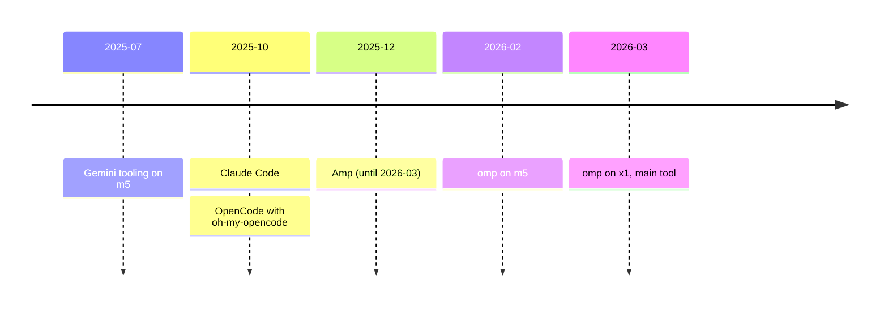
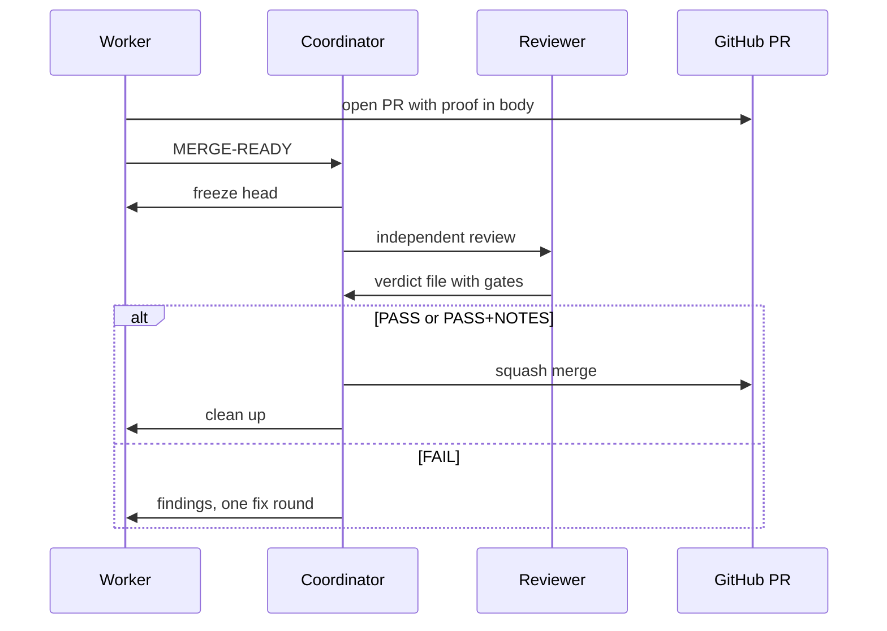

# Benchmarking My Coding Agent Setup: One Engineer, Many Agents
## Presenter outline, live talk for SWE Growth

**SWE Growth community (Mas Zikrul), online on Zoom**
**90 minutes. All slides in English.**
**Speaker: Zahid**

## Notes for the presenter
- Total plan is 47 slides and about 72 minutes of talking. The other 18 minutes are slack (1 to 3 minutes per section), the live demo, and 6 minutes of Q&A at the end.
- Pillar 1 is the benchmark lab (slides 11 to 15). It is the part that matches the title, so protect it. It has no slack. Cut elsewhere first.
- Slide timing is minutes of talking. The clock value is the section start plus the running total. It is the target, not a promise.
- Label **[Wajib]** means keep the slide. Label **[Opsional]** means cut it if time is short.
- Rule for every slide. One idea, at most three key points, and the picture does the work.
- Say "API-equivalent" every time a dollar figure appears. It is the list price of the tokens, not money paid.
- The claim, which every section supports or limits. "The model is a swappable part. What lets one engineer ship from a phone is the setup around it: skills, proof, coordination, and guardrails."
- Live demo checkpoints. Start at about minute 15 (slide 9). Check the PR at about minute 60 (slide 35). A recorded backup of the full run is ready. The phone screen is shared next to the laptop.

## Run of show

| Clock | Section | Slides | Talk time | Organizer questions |
|---|---|---|---|---|
| 0:00 to 5:00 | Cold open | 1 to 4 | 5 min | none |
| 5:00 to 15:00 | The journey | 5 to 8 | 8.5 min | 1 |
| 15:00 to 30:00 | Pillar 1, the benchmark lab (demo starts) | 9 to 17 | 14 min | 2, 3, 11 |
| 30:00 to 45:00 | Pillar 2, knowledge | 18 to 25 | 12.5 min | 5, 7, 8 |
| 45:00 to 65:00 | Pillar 3, the crew (demo check) | 26 to 36 | 18.5 min | 4, 6, 9 |
| 65:00 to 75:00 | Infra and guardrails | 37 to 41 | 7.5 min | 10 |
| 75:00 to 82:00 | Open problems | 42 to 44 | 4 min | 12 |
| 82:00 to 90:00 | Close and Q&A | 45 to 47 | 2 min plus 6 min Q&A | none |

Total talk time is 72 minutes (5 + 8.5 + 14 + 12.5 + 18.5 + 7.5 + 4 + 2).

## Cut order if time is short
Cut in this order. Each cut saves about the time shown.
1. Slide 23 (compaction), 1.5 min. Say one sentence on slide 22.
2. Slide 38 (terminal journey), 1.5 min. Say the five names in one breath.
3. Slide 29 (long runs, one writer per branch), 1 min. Slide 32 carries the key quote.
4. Slide 39 (per-worktree setup), 1 min.
5. Slide 25 (why beads was dropped), 1 min. Say one sentence on slide 24.
6. Slide 14 (handoff arms), 1 min. Keep the line "every arm passed, so speed and cost separate" on slide 12.

The core stays intact. The claim, the benchmark lab (slides 11 to 13 and 15), the cost slide, skills, mesh and the coordinator loop with base-branch coordination, the proof ladder, and open problems.

## Coverage of the 12 organizer questions

| # | Question | Slides |
|---|---|---|
| 1 | Tool evolution and why each switch | 5, 6, 7, 8 |
| 2 | Model routing per role | 10, 12 |
| 3 | Effort and thinking level | 10, 13 |
| 4 | Orchestration and parallel agents | 26, 27, 28, 32, 33 |
| 5 | Task and spec management, beads | 24, 25 |
| 6 | Long-horizon runs and guardrails | 29, 32 |
| 7 | Memory and context | 18, 21, 22, 23 |
| 8 | Own skills, favorites | 19, 20, 27, 30, 31 |
| 9 | Review and quality gate, manual checks | 31, 34, 36, 42 |
| 10 | Supporting infra | 37, 38, 39, 40, 41 |
| 11 | Cost and subscription strategy | 11, 12, 14, 15, 16, 17 |
| 12 | Open problems | 42, 43, 44 |

---

# Section 1. Cold open (0:00 to 5:00)

## Slide 1 [Wajib] Title
**Timing:** 0.5 min (clock 0:00)
**Key points**
- Benchmarking My Coding Agent Setup: One Engineer, Many Agents.
- SWE Growth community, online.
- Zahid.

**Visual hint:** Title card. Dark background, one line of subtitle. No logos of model vendors.
**Speaker note:** Thank the organizer and say hello. Say this is a casual talk about one real setup, with real numbers, including what still does not work.

## Slide 2 [Wajib] The 9:29 phone screenshot
**Timing:** 1.5 min (clock 0:30)
**Key points**
- Tuesday, 27 October 2026, 9:29 in the morning, WIB.
- An omp session on a phone, chat style, with a mic in the composer.
- I was already on board the plane, before takeoff.

**Visual hint:** Full-slide phone screenshot `screenshot-omp-mobile-0929.png`. Circle the 9:29 clock and the mic.
**Speaker note:** "This is my phone at 9:29. I was sitting in the plane, before takeoff. The agent had just reproduced a bug on a real stack and was about to fix it. Let me show you how I got there."

## Slide 3 [Wajib] PR #804, from QA warning to QA pass in 65 minutes
**Timing:** 1.5 min (clock 2:00)
**Key points**
- 08:52 QA posts a warning on an already approved PR. Clicking a draft sensor opens the edit modal.
- 09:26 I paste the finding into the session from the phone. "Fix those own changes proof and update pr".
- 09:29 before recording, 09:30 after recording and push, 09:31 PR body updated, 09:57 QA passes.

**Visual hint:** Horizontal timeline with five markers (08:52, 09:26, 09:29, 09:31, 09:57). Small mermaid sequence on the right if there is room. Source is the PR #804 loop in the mesh reference.
**Speaker note:** "QA found one more thing on a PR that was already approved. I pasted it into the same session. The agent recorded a before clip, fixed it, recorded an after clip and updated the PR body. QA tested the PR itself and passed 65 minutes after the warning."

## Slide 4 [Wajib] The claim, and the four parts around any model
**Timing:** 1.5 min (clock 3:30)
**Key points**
- "The model is a swappable part. What lets one engineer ship from a phone is the setup around it."
- Four parts around the model: skills, proof, coordination, guardrails. Three pillars today: the engine, knowledge, the crew.
- Outside evidence. Can Bölük, the author of omp, "I improved 15 LLMs at coding in one afternoon. Only the harness changed." (X, link on the slide)

**Visual hint:** Diagram. A small box "model" in the center with four boxes around it. Under it, a strip of the three pillars with minute marks. The Can Bölük quote as a small card in the corner, with his name and "omp author, Stencil".
**Speaker note:** State the claim slowly. Tell the audience that every section either supports it or shows where it breaks. Promise one action to take home at the end.

---

# Section 2. The journey (5:00 to 15:00)

## Slide 5 [Wajib] What is a harness?
**Timing:** 1.5 min (clock 5:00)
**Key points**
- A harness is the program around the model. It gives the model tools, context, memory, and rules.
- Claude Code, Cursor, OpenCode, Amp and omp are harnesses. Claude, GPT and GLM are models.
- Swap the model and keep the harness, or the other way around. This talk is about the harness.

**Visual hint:** Two-layer diagram. Bottom layer "model", top layer "harness: tools, context, memory, rules". Name the audience's own tools on the top layer.
**Speaker note:** Many of you use Claude Code or Cursor, so this is a short refresher. Keep it to two sentences and move on.

## Slide 6 [Wajib] My tool journey, in order
**Timing:** 2.5 min (clock 6:30)
**Key points**
- Gemini tooling on the Mac (m5) in July 2025, then Claude Code 2025-10-19, then OpenCode with oh-my-opencode 2025-10-20 (215 sessions on m5).
- Amp from 2025-12-22 to 2026-03-16, the longest stay. omp on m5 from 2026-02-23, on the x1 workstation main since 2026-03-07.
- Two machines. First m5, a Mac. Then x1, a Linux workstation that runs everything now.

**Visual hint:** Mermaid timeline or horizontal bars from July 2025 to November 2026. Bars overlap where I tried two tools at once.
**Speaker note:** "This is from my own files, not from memory. The dates are the first session I find for each tool." Point out the overlap between Amp and omp.



## Slide 7 [Wajib] Why each switch
**Timing:** 2 min (clock 9:00)
**Key points**
- Antigravity, briefly. Good free usage, plan annotations, session artifacts. Then heavy, and quality and limits got worse. My Google account also got banned.
- Claude Code to oh-my-opencode. Some tasks were not good enough and I wanted more efficiency. It is an extension of OpenCode, so it had limits and quality was lower. Claude and OpenAI subscriptions were getting banned on OpenCode.
- To Amp. More mature. I mostly used a proxy (CLIProxyAPI) to get very large usage. It had cross-agent communication and could spawn other agents.

**Visual hint:** Table with three columns. Tool, what I liked, why I left. Add the OpenChamber web UI as a note on the OpenCode row.
**Speaker note:** Be honest. Say the reasons are about my workload and the time, not a verdict on the tools.

| Tool | What I liked | Why I left |
|---|---|---|
| Antigravity | Free usage, plan annotations, session artifacts | Heavy, quality and limits, account ban |
| Claude Code | Where I started | Some tasks not good enough, wanted more efficiency |
| oh-my-opencode on OpenCode | Pure CLI, then the OpenChamber web UI | Many issues, subscription bans |
| Amp | Mature, cross-agent messages, spawn agents | "I forgot why I left Amp" |

## Slide 8 [Wajib] Why omp
**Timing:** 2.5 min (clock 11:00)
**Key points**
- "I forgot why I left Amp, but omp is better because" it is extensible. I write my own plugins.
- Autolearn, Hindsight memory, multi-provider subscription logins, and good compaction.
- That extensibility is why the later slides exist. Mesh, the org account router and the worktree plugin are all mine.

**Visual hint:** Five-icon row (plugins, autolearn, memory, logins, compaction). Add one small screenshot of `ls ~/.omp/agent/extensions/`.
**Speaker note:** Say the joke about forgetting once. Then give the real answer. A harness you can extend lets you fix your own problems, which is why the setup keeps moving.

---

# Section 3. Pillar 1, the benchmark lab (15:00 to 30:00)

Pillar 1 is built on `references/referensi-benchmark-lab.md`. The story is one engineer who measures. A value formula, a bench of his own, a finding about effort, a handoff trick he tested and turned off, and a subscription journey that ended with "all in on Claude 5.5".

## Slide 9 [Wajib] Live demo, start from the phone
**Timing:** 1 min (clock 15:00)
**Key points**
- A small real issue from the Alkhidmah backlog.
- I send one prompt from the Tern Android app. The agent works while I keep talking.
- Goal is a PR with proof in the body. We check it at about minute 60.

**Visual hint:** Live. Phone mirror next to the laptop, Tern session open, the prompt typed in my own style (for example "create new worktree, trace the impacted flow, fix, open a pr with proof in the body, coordinate with SHIP poteto"). Backup is the recorded video.
**Speaker note:** Say that the audience sees my real phone. If the live run fails, switch to the recording and say so. Send the prompt, then go straight to the next slide.

## Slide 10 [Wajib] Model routing per role and the effort rule
**Timing:** 1.5 min (clock 16:00)
**Key points**
- Each role has a model and an effort level. Default is Opus at low. Plan is Opus at high. Reviewer is Opus at medium. Task agents run Sonnet at medium. Scout and sonic run Haiku, the fast model.
- Effort rule. Low for execution, high for plans and hard debugging, medium for review, max almost never. The next slides test the first half with a bench.
- Routing is config. A fallback chain and a second account take over when a quota runs out. Speed since October (Anthropic, average per request) is Haiku 130 output tokens per second, Sonnet 95, Opus 66.

**Visual hint:** Table of roles (default, plan, reviewer, advisor and designer, task, scout and sonic) with model and effort. One small speed strip under it. Add the `modelRoles` block from `config.yml`, cropped so no account details show.
**Speaker note:** "I do not pick a model per prompt. I pick it once per role. The expensive model plans and reviews. The cheap fast model explores. Effort is not recorded per request, so I cannot chart it from my usage. That is why I built a bench." Time to first token is 2.6 seconds for Opus as main against 1.4 for Haiku.

| Role | Model | Effort |
|---|---|---|
| default | Opus | low |
| plan, slow | Opus | high |
| reviewer | Opus | medium |
| advisor, designer | Sonnet | high |
| task agents | Sonnet | medium |
| scout, sonic, smol | Haiku | fast |

## Slide 11 [Wajib] The value formula
**Timing:** 1.5 min (clock 17:30)
**Key points**
- A price per million tokens lies, because a subscription changes what a token costs. Value Multiplier is quota dollars divided by subscription cost. Effective price per 1M is blended price divided by the multiplier.
- Value Score is the benchmark divided by the effective price. The speed-adjusted score also multiplies by tokens per second. It catches "$25 per 1M versus $2 per 1M at the same performance".
- Rules. One common benchmark only (Terminal-Bench 2.1). Count the accounts. `cost_total` is API-equivalent, not spend. GLM is verbose, so compare tokens used too.

**Visual hint:** The four formula lines in a code block. Under it one September example row, DeepSeek V4.1-Flash (90.6, about 118 tokens per second) against GLM-5.3 (88.2, about 42).
**Speaker note:** "This is how I decided what to buy. It is a spreadsheet, not a feeling." Say the September numbers are a point in time.

```text
Value Multiplier    = Quota $ / Subscription cost
Effective $/1M      = Blended $/1M / Value Multiplier
Value Score         = Benchmark / Effective $/1M
Speed-adjusted QSPD = (Benchmark x tok/s) / (Effective $/1M x 1000)
```

## Slide 12 [Wajib] My own bench, October 2026
**Timing:** 2 min (clock 19:00)
**Key points**
- Two easy tasks, a UI page and a slot finder. Three runs each, hidden-check graders, medians.
- Every arm passed 126 of 126 checks. So quality did not separate the models. Speed and cost did.
- Opus low is fastest. Haiku medium is cheapest of the Claude arms. DeepSeek is cheap per token and the slowest arm.

**Visual hint:** Table with the solo arms (UI time, slot finder time, cost per task). Big line "126/126 on every arm". Source is `omp-ops/references/model-bench-results.md`.
**Speaker note:** "Cost is list price, API-equivalent. DeepSeek lost on turns, not on speed per call. It made far more turns." Say this is two easy tasks, not a quality ranking.

| Setup | UI | Slot finder | Cost per task (API-equivalent) |
|---|---|---|---|
| Opus 5.5 low | 92 s | 54 s | $0.22 to $0.39 |
| Sonnet 5.5 medium | 94 s | 84 s | $0.17 to $0.24 |
| Spark 1.3 low | 103 s | 71 s | $0.08 to $0.15 |
| Haiku 5.5 medium | 170 s | 120 s | $0.02 to $0.03 |
| Wonder 1.0 low | 136 s | 252 s | $0.39 to $0.41 |
| DeepSeek v4.1 flash low | 476 s | 275 s | $0.04 to $0.07 |

## Slide 13 [Wajib] Effort versus turns
**Timing:** 1.5 min (clock 21:00)
**Key points**
- Raising effort raised the turn count in every head-to-head pair. Spark slot finder went from 9 to 23 turns. DeepSeek UI went from 28 to 40.
- The likely cause is checking. Higher effort re-reads and re-checks, and each check is a turn. This cause is an inference. The turn counts are measured.
- My rule stays. Low for execution, high for plans and hard debugging, medium for review, max almost never.

**Visual hint:** Paired bars for four rows (Haiku slot finder 12 to 16, Spark slot finder 9 to 23, Sonnet UI 7 to 10, DeepSeek UI 28 to 40). The rule line under it.
**Speaker note:** "I expected low effort to cost more steps. It was the other way round on these tasks." Say it covers execution on easy work. The "high for plans" half is my judgment.

## Slide 14 [Opsional] Handoff arms, and what the bench cannot say
**Timing:** 1.5 min (clock 22:30)
**Key points**
- Opus low to Sonnet medium cost $0.35 to $0.48 per task. Sonnet medium to Haiku medium cost $0.17 to $0.36. On short tasks a handoff costs extra, because the second model re-reads.
- Real long sessions (50 or more turns, estimates from logs, not graded). Sonnet medium alone $2.58 per task. Sonnet medium to Haiku medium $1.63, at about the same time.
- Caveat. Public Terminal-Bench 4.0 has Haiku 5.5 at 39.2% and Sonnet 5.5 at 70.6%. Haiku on long multi-step work is unproven.

**Visual hint:** Two handoff rows next to the solo rows they came from. A warning card, "easy tasks, 3 runs, not a quality ranking".
**Speaker note:** "A handoff is not a free discount. It pays off when reading is the cost, which means long sessions." This leads into prewalk.

## Slide 15 [Wajib] Prewalk, a handoff I tried and turned off
**Timing:** 2 min (clock 24:00)
**Key points**
- What it is, from the omp docs. A one-shot handoff from the active model to a faster or cheaper one after planning reaches implementation. A successful todo opens the gate, and at the first edit the session switches and drops the planning instruction. Off by default.
- Can Bölük, the omp author. "Opus fixing things does not cost money. Opus reading things costs money." Only 9% of 1.81B tokens in his data were edits. His receipts on SWE-Bench Pro. GPT-5.6 Sol prewalk into Luna 85% pass, $1.04, 300 s, against Sol alone 88%, $1.71, 372 s. Opus 4.8 prewalk into Flash 78%, $1.46, against Opus alone 85%, $2.78.
- My own experience. It took extra time on some tasks. Haiku was too expensive as the target, DeepSeek too slow. It is off now.

**Visual hint:** Left, the two quotes ("Opus reading things costs money." and "Hand off a trajectory, not a fairytale."). Middle, the two receipt rows. Right, a card "Zahid, prewalk, off now" with the two reasons.
**Speaker note:** Say that the receipts are the author's numbers on SWE-Bench Pro, not mine. "Plan with the strong model, execute with the cheap one. It pays off on long sessions and costs more on short tasks. For my work it is off for now." Lesson. Test a trick on your own workload.

## Slide 16 [Wajib] Cost, October 2026
**Timing:** 1 min (clock 26:00)
**Key points**
- October 2026. 270k requests, 41B tokens, $7.3k API-equivalent. I paid about $200. That is roughly 36 times less.
- 97% of tokens were cache reads. Without caching the same work prices at $58.2k. Two thirds of requests came from subagents.
- I pay for 2x Claude Max and OpenCode Go. Usually about $100 a month, now about $200 because I push a lot.

**Visual hint:** One big number pair. "$7.3k" struck against "about $200". Under it a bar chart of requests per month from March to November (36k, 0.8k, 2.2k, 23k, 46k, 174k, 235k, 270k, 47k for 1 to 5 November).
**Speaker note:** "API-equivalent means the list price of these tokens. It is not money I paid. The point is that one flat subscription plus caching carries a lot of work."

## Slide 17 [Wajib] The subscription journey, ending in all in on Claude 5.5
**Timing:** 2 min (clock 27:00)
**Key points**
- September 2026. GLM Max, my own one-year plan bought cheap at the launch price. Codex Pro from the office. Devin Pro and OpenCode Go, my own. The default model was GLM-5.3.
- Eight months, at least 12 providers, by requests. Anthropic 240k, GLM 224k, Codex 128k. In October Anthropic had 187k of 270k requests. November so far is Anthropic only.
- Then the Claude 5.5 series arrived and I went all in on Claude. "Claude 5.5 series quality is GOAT." Now 2x Claude Max and OpenCode Go.

**Visual hint:** Two columns, September and now, with each plan tagged "own" or "office". A bar chart of requests per provider under it, small.
**Speaker note:** "The formula says which plan is cheap. It does not say which model is good. When quality moved, I moved." Close the section with "The model is the part I swap most often", and link back to the claim and the harness quote on slide 4.

---

# Section 4. Pillar 2, knowledge (30:00 to 45:00)

## Slide 18 [Wajib] Skills are for TIL, memory is for cross-project
**Timing:** 1 min (clock 30:00)
**Key points**
- "Skills and references are for TIL and reusable knowledge, while memory is what you do cross-project."
- Skills hold how to do a thing. Memory holds what I did and decided.
- Two stores, two jobs. Today we look at both.

**Visual hint:** Two columns with the quote above them. Left "skills and references", right "memory".
**Speaker note:** Say TIL means "today I learned". Give one example for each side.

## Slide 19 [Wajib] The skill rule
**Timing:** 2 min (clock 31:00)
**Key points**
- "When you see you are doing the same work more than twice, it is a candidate for a skill, so the agent can do it for you."
- This is the one action I want you to take home.
- A skill is a short file the agent loads when the work matches. It can include playbooks (steps to follow) and references (facts to look up).

**Visual hint:** The quote in large type. Under it a small folder tree `SKILL.md`, `playbooks/`, `references/`.
**Speaker note:** Tell one honest story. A routine you repeated three times, like a deploy or a WhatsApp template check, became a skill. Say this slide returns at the close.

## Slide 20 [Wajib] Area skills, one per domain
**Timing:** 2.5 min (clock 33:00)
**Key points**
- 14 area skills, one folder per domain, not per task. Examples are infra-ops, groundup-ops, alkhidmah-ops, git-pr-workflow, omp-ops, comms-ops, thesis-ops.
- `SKILL.md` is only a router. Playbooks are step lists to follow. References are facts to look up.
- A lint script checks layout and exits 1 on errors. A pre-commit hook runs it. The layout rule became a script, not a longer instruction.

**Visual hint:** Tree diagram. `managed-skills/` with 14 domain folders, one expanded (`infra-ops/` with `SKILL.md`, `playbooks/`, `references/`). Add a terminal screenshot of the lint summary line (run it before the talk).
**Speaker note:** "A task reads one router and then one playbook. Unrelated work stays out of each other's context. When a lesson shows up, it goes into the matching area skill, not into a new skill."

```text
managed-skills/
  infra-ops/
    SKILL.md        router only
    playbooks/      step lists to follow
    references/     facts to look up
  groundup-ops/  alkhidmah-ops/  git-pr-workflow/  omp-ops/  comms-ops/ ...
```

## Slide 21 [Wajib] Autolearn story
**Timing:** 1.5 min (clock 35:30)
**Key points**
- I turned autolearn on and let it mint skills after each session. It minted too many.
- I consolidated them into 14 domain skills and added the lint.
- Now I trigger autolearn by hand, after a session that taught something.

**Visual hint:** Three-step line. Many small skills, 14 domain skills plus lint, manual trigger. Small config line `autolearn: { enabled: true, autoContinue: false }`.
**Speaker note:** "Auto-on was too much noise. A human decides what is worth keeping. That is a small guardrail for knowledge, not for code."

## Slide 22 [Wajib] Memory journey
**Timing:** 2 min (clock 37:00)
**Key points**
- Mnemopi to Hindsight on 2026-06-28. Cognee tried in September 2026 and destroyed on 2026-10-19.
- Hindsight keeps the cross-project facts. It retains every 10 turns, because retaining on every run is the most expensive option.
- The old data stayed untouched, so rollback is one config flip.

**Visual hint:** Three-stage timeline (Mnemopi, Hindsight, Cognee tried and removed). Config snippet below.
**Speaker note:** "I do not trust one memory tool. I tried three. Hindsight stayed because it fits the cross-project job and the cost is controlled."

```yaml
memory:
  backend: hindsight
hindsight:
  retainMode: last-turn
  retainEveryNTurns: 10
  retainOverlapTurns: 2
```

## Slide 23 [Opsional] Context and compaction
**Timing:** 1.5 min (clock 39:00)
**Key points**
- Compaction tries three methods in order. snapcompact, then remote, then soft.
- It starts at 70% of the context window, and compacts when idle after 60 seconds.
- Good compaction is one reason I dropped task tracking tools.

**Visual hint:** Small flow with three boxes (snapcompact, remote, soft) and the 70% threshold line on a bar.
**Speaker note:** Keep it practical. "You do not need to watch the context window. You need a harness that compacts well and a memory layer behind it."

## Slide 24 [Wajib] Specs and instructions
**Timing:** 1 min (clock 40:30)
**Key points**
- I paste raw context. QA's WhatsApp message, screenshots, spreadsheets. No ticket needed. The structure is in the rules, not in my prompt.
- Instructions are layered. A short global file, small rule files, and a repo AGENTS.md where the nearest file wins and a size budget is checked.
- When I hand work to subagents, the brief has one shape. Target, Change, Contract.

**Visual hint:** Layer diagram (global file, rules, repo AGENTS.md, nested AGENTS.md). Next to it a short brief example with the three headings.
**Speaker note:** "My prompts are loose on purpose. The agent finds structure in the files around it. The brief shape is what I use one level down."

## Slide 25 [Wajib] Why beads was dropped
**Timing:** 1 min (clock 41:30)
**Key points**
- Agents got smarter, so they need less task tracking.
- Beads is not really human-readable.
- Agents keep context better now with compaction and the memory layer. I use GitHub issues plus coordinator ledgers instead.

**Visual hint:** Strike-through "beads" with the replacement "GitHub issues plus ledgers" next to it.
**Speaker note:** "This is the one tool I used on purpose and then removed. It is fine to remove a tool when the model gets better."

---

# Section 5. Pillar 3, the crew (45:00 to 65:00)

## Slide 26 [Wajib] Worktrees, one per task
**Timing:** 2 min (clock 45:00)
**Key points**
- Every task gets its own git worktree, so agents never share a working directory.
- My plugin `tern-worktrees` has three parts. A Tern plugin (branch picker, keep or tear down on close), a CLI `tern-wt`, and a skill that is the contract agents follow.
- `tern-wt` prints one JSON object with stable error codes such as `dirty_worktree`. A copy-on-write clone brings `.env` and `node_modules` along.

**Visual hint:** Terminal screenshot of `tern-wt list --all` (JSON, no private paths). Under it, the rule "use tern-wt, not git worktree".
**Speaker note:** "One CLI is the one implementation of each git and GitHub step. The skill tells the agent to use it and not to remove a worktree it did not create."

## Slide 27 [Wajib] My custom omp plugins
**Timing:** 1.5 min (clock 47:00)
**Key points**
- omp-agent-mesh (my own Effect-based engine) is the hero. It lets parallel agents see each other.
- omp-org-account-router. Office account for office repos, personal accounts for personal repos. tern-worktrees. poteto-mode extension that autoloads the skill once per context.
- Also paseo-omp (237 commits in Sep to Oct 2026), opencode-go-multi-auth, and herdr state hooks.

**Visual hint:** Card grid. One large card "mesh", then smaller cards with a one-line purpose each. Mark retired items (muse-sub retired 2026-10-10) in grey.
**Speaker note:** "This is the reason I chose omp. When something hurts, I write a plugin. The mesh plugin took seven commits over two days."

## Slide 28 [Wajib] Mesh, how agents talk
**Timing:** 2 min (clock 48:30)
**Key points**
- Many omp sessions share one machine, one set of ports, one Docker daemon. Mesh stops two agents running the same heavy job or editing the same file.
- Actions are `peers`, `note`, `send`, `broadcast`, `claim`, `release`. Edits to a file another agent claimed are blocked automatically.
- The shared event log had 10,083 lines on 2026-11-05. 101 session files used the tool.

**Visual hint:** Live or screenshot. `mesh peers` output and the global AGENTS.md block "run `peers` before shared work". Optional one-minute live `peers` call if the clock is early.
**Speaker note:** "Before heavy work, an agent checks who else is working. If a peer is running the same Docker job, it waits and sends a message instead of running in parallel."

```text
Other omp agents may be running in other sessions. Run the mesh tool with action peers
before work that touches shared resources.
```

## Slide 29 [Opsional] Long runs need one writer per branch
**Timing:** 1 min (clock 50:30)
**Key points**
- Idle sessions do not wake on mesh messages. A session that ended never sees a broadcast.
- So each branch gets one writer. A dead owner is replaced by a fresh one, and the reason goes into the ledger.
- Subagents and sessions outside the configured roots get `MESH_NOT_JOINED`.

**Visual hint:** The ledger row as a quote card, with the date 2026-11-02.
**Speaker note:** "This is the lesson from running agents for days. Messages are not enough. Ownership has to be clear."

> started fresh owners for #488 ... because their sessions had ended and never saw the broadcast
> idle sessions don't wake on mesh messages; each branch needs one writer

## Slide 30 [Wajib] The poteto skill set, ported to omp
**Timing:** 1.5 min (clock 51:30)
**Key points**
- poteto-mode is an agent style skill from the pstack plugin (MIT, upstream by poteto). I ported it to omp and keep a fork.
- 25 principles and 23 playbooks. Examples are Prove It Works, Fix Root Causes, Never Block on the Human, and playbooks for bug fix, babysit, shipping and orchestrate.
- The skill demands a visible effect. The reply must name each principle that shaped a decision and the choice it changed.

**Visual hint:** Two columns. Left "25 principles" (11 core, 6 architecture, 5 verification, 2 delegation, 1 meta). Right a short list of playbook names.
**Speaker note:** Explain the keyword. I end many prompts with the word "poteto", and an extension loads the skill once per context. Run the count of principles and playbooks before the talk and say the real number.

## Slide 31 [Wajib] My favorite, principle-check-every-layer
**Timing:** 1.5 min (clock 53:00)
**Key points**
- It is my own principle, added on top of poteto.
- For any design, plan, review or build, give findings on three layers or one line on why a layer does not apply. Product and the human walk, structure, and data and flow.
- A rule file loads it on every turn for the main agent, reviewers and task agents.

**Visual hint:** Three stacked layers (product and UX, structure, data and flow) with an example finding on each. Add the one-line rule file.
**Speaker note:** "Agents fix the layer they are looking at. This rule forces them to look at the other two."

## Slide 32 [Wajib] The SHIP coordinator loop
**Timing:** 2.5 min (clock 54:30)
**Key points**
- A coordinator is an ordinary omp session, not a daemon. The SHIP run lasted about three days (2 to 5 November) and kept a 276-line ledger.
- Worker contract. Do not merge. Send `MERGE-READY #<pr> <full sha>`. Freeze the head. An independent reviewer reviews it. One fix round, in one push.
- Product questions go to the coordinator, not to me. Each decision is one row with a reason. The ledger columns are ts, phase, decision, why, evidence, result.

**Visual hint:** Mermaid sequence diagram (worker, coordinator, reviewer, PR). Next to it three real ledger rows with customer names removed.
**Speaker note:** "I do not watch every branch. I watch one coordinator. When a reviewer proves a PR leaks data on a throwaway database, the coordinator decides whether it blocks the release, and writes down why."



## Slide 33 [Wajib] Base branch coordination, solved by mesh and one coordinator
**Timing:** 1.5 min (clock 57:00)
**Key points**
- Many PRs against one base branch need someone who knows the state of every branch. This is solved by my omp-agent-mesh plugin plus one spawned coordinator agent that guides the workers.
- One writer per branch. Workers never merge. The coordinator merges in sequence after an independent review.
- When mesh cannot reach a worker, the coordinator reads that worker's session file and types into its tab. The loop still runs.

**Visual hint:** Diagram of one coordinator with workers on separate branches. Solid lines for mesh messages, dotted lines for the session-file fallback. A line of text under it, "one writer per branch, merge in sequence".
**Speaker note:** "This used to be my hardest problem. It is not an open problem for me now. I do not watch every branch. I watch one coordinator." Link to slides 28, 29 and 32.

## Slide 34 [Wajib] Review report and gates
**Timing:** 1.5 min (clock 58:30)
**Key points**
- The verdict is frozen at one commit. Example "Frozen verdict: PASS+NOTES at head 592b92ae9".
- A gates table. `verify.ts` verdict PROVEN (red on master, green on head, desktop 1280 and mobile 390), merge-tree clean, check-types, architecture lint, unit and e2e on a throwaway database that is removed after.
- Findings are tagged P2 or P3 with confidence, file and line, and a fix. Real FAILs included a README command that errored when run as written.

**Visual hint:** Screenshot or table of the review report header and the gates rows. Remove customer names first.
**Speaker note:** "The reviewer does not trust the author. It runs the README verbatim in a clean worktree and tests on a throwaway database." Say what I still check by hand. UI and visual feel.

## Slide 35 [Wajib] Demo check, the PR from the phone
**Timing:** 1.5 min (clock 60:00)
**Key points**
- Open the PR from the demo.
- Does the body have Why, proof, and an honest "Not verified"?
- Show the recording or screenshots the agent attached.

**Visual hint:** Live. The PR page in the browser, scrolled to Verification. Backup is the recorded run.
**Speaker note:** If the run finished, walk through the body in 60 seconds. If it did not finish, say what step it is on and show the recording. Do not wait for it.

## Slide 36 [Wajib] PR body shape and the proof ladder
**Timing:** 2 min (clock 61:30)
**Key points**
- A PR body is a briefing, one minute for a reviewer who already has the diff. Sections in order are Why, How, What changed, Scope, Tradeoffs, Blast Radius, Verification.
- Verification has one bullet per claim, proof beside it, and ends with "Not verified:" and a list, or "Not verified: none".
- Proof ladder. Take the first rung that shows the claim. Recording for visible behavior (before and after for a bug). Command and real output for API or CLI. Run link for CI. Test command and result when nothing is visible.

**Visual hint:** Left, the seven section names as a stack. Right, a four-rung ladder. Screenshot of PR #804 Verification with before and after clips.
**Speaker note:** "There is no magic validate command. Proof comes from the Prove It Works principle and this PR shape. Every proof link is one the agent produced or opened in that session." Mention that GinaV2 PRs open as drafts.

---

# Section 6. Infra and guardrails (65:00 to 75:00)

## Slide 37 [Wajib] Infra map
**Timing:** 1.5 min (clock 65:00)
**Key points**
- x1 is the Linux workstation that runs the agents. The Mac (m5) is for review and browser. Both are on one private network.
- A shared dev box runs one compose stack per user, so proof comes from a real running stack away from the workstation. Another box handles batch jobs and the NAS. An office box runs staging.
- Cloud production is reached through IAP tunnels and is read-only by default.

**Visual hint:** The machine map as a mermaid flowchart (workstation, Mac, tailnet, WireGuard LAN boxes, cloud project, hosted boxes). No IPs or host addresses.
**Speaker note:** "Agents use plain ssh aliases. I never show the ssh config on stage. The point is separation. The workstation is busy with agents, so proof runs elsewhere."

## Slide 38 [Wajib] Terminal journey
**Timing:** 1.5 min (clock 66:30)
**Key points**
- OpenChamber, then the Ghostty terminal (windows and tabs) because of omp, then herdr for worktrees and sessions.
- Tried Paseo to get something easier with more managed worktrees. Stopped its daemon on 2026-10-16.
- Now Tern, from Stencil, and I just use Tern. It has an Android app for the phone.

**Visual hint:** Five-step horizontal line (OpenChamber, Ghostty, herdr, Paseo, Tern) with dates where known (herdr 2026-06-27, Paseo evaluated 2026-06-23).
**Speaker note:** "Each step removed one chore. I stopped on Tern because worktrees, tabs and the phone are in one place."

## Slide 39 [Opsional] Per-worktree setup
**Timing:** 1 min (clock 68:00)
**Key points**
- One command takes a fresh worktree to a running stack. For Alkhidmah, `bun run bootstrap`.
- Ports and database tier come from arithmetic on the branch slug, so two worktrees never fight over a port.
- GinaV2 uses one shared env file, symlinked as `.env` in every checkout.

**Visual hint:** Code snippet of the quote below, and a small table of the three database tiers (shared, branch fork, own container).
**Speaker note:** "The agent never configures a stack by hand. The setup is in the repo, so a new worktree is a command."

```text
From a fresh clone (or a fresh worktree): bun run bootstrap
```

## Slide 40 [Wajib] Secrets and damage control
**Timing:** 1.5 min (clock 69:00)
**Key points**
- omp obfuscates secrets by default. The model sees placeholders, not values.
- Damage-control rules block `rm -rf`, `git reset --hard`, force push, `DROP TABLE`. `~/.ssh/` is zero access. `.env` files are read-only.
- Secrets come from Infisical (machines) or Bitwarden (humans). Never print them. In my own words, obfuscation is not secret management.

**Visual hint:** Three small cards (obfuscation, damage-control rules, secret managers). Show the rules file with `zeroAccessPaths` and `readOnlyPaths`.
**Speaker note:** "These are layers. The first hides values from the model. The second limits what a command can do. The third decides where values live."

## Slide 41 [Wajib] Production is read-only, dry run first
**Timing:** 2 min (clock 70:30)
**Key points**
- Prod is read-only by default. No writes without approval. Show the plan before anything heavy.
- Every write goes dry run, backup, guarded apply, verify. Dry run runs the real update inside a transaction, rolls back, and prints the preview table and counts. Apply needs `--apply`, and a wrong row count rolls back.
- A deploy is done only when the running version is verified, not when the job is green.

**Visual hint:** Four-step flow (dry run, backup, apply with expected counts, verify). Quote card with "dry run first then show me what will be changed".
**Speaker note:** Give the real prompt. "I tell the agent dry run first and show me the list, so a colleague can confirm." Then the deploy lesson. The deploy call is an acceptance receipt, not a rollout receipt.

---

# Section 7. Open problems (75:00 to 82:00)

## Slide 42 [Wajib] Open problem, the agent UI and the manual checks
**Timing:** 1 min (clock 75:00)
**Key points**
- Agent-built UI is still fat and ugly. It needs design skills and my manual feedback.
- The things I still check by hand are UI and visual feel, and UX.
- Proof clips show that a button works. They do not show that it looks right.

**Visual hint:** Two screenshots side by side. One agent-built screen before design feedback, one after. (Pick from the Alkhidmah work, no customer data.)
**Speaker note:** "This is honest. The agent can prove a flow works. It cannot yet tell me the screen feels right."

## Slide 43 [Wajib] Open problem, env and seeding per worktree
**Timing:** 1.5 min (clock 76:00)
**Key points**
- Setting up a database and seed per worktree is slow and heavy.
- One fix took a seed from 652 s to 171 s.
- Every new worktree pays this cost, and agents create many.

**Visual hint:** Bar pair, 652 s against 171 s. Under it, a line "still 171 s per worktree".
**Speaker note:** "Parallel agents are only as cheap as a worktree is. 171 seconds is better, and still too slow."

## Slide 44 [Wajib] Open problem, RAM on the shared box
**Timing:** 1.5 min (clock 77:30)
**Key points**
- Agents and two CI runners share one workstation. An uncapped test run reached 38 GB.
- A rule now fires when test commands appear. It tells the agent to cap memory and check free RAM first.
- The verify script refuses to run below 15 GiB free.

**Visual hint:** Memory graph or simple number card "38 GB". Below it the rule frontmatter with its `condition:` regex.
**Speaker note:** "The fix was a rule that fires on the command, not a memory upgrade. A rule with a regex condition is a cheap guardrail."

---

# Section 8. Close and Q&A (82:00 to 90:00)

## Slide 45 [Wajib] The claim, and one action
**Timing:** 1 min (clock 82:00)
**Key points**
- The model is a swappable part. Skills, proof, coordination and guardrails are the setup around it.
- One action for Monday. "When you see you are doing the same work more than twice, it is a candidate for a skill, so the agent can do it for you."
- Two small habits that cost nothing. Ask for proof in every PR. Dry-run anything that touches production.

**Visual hint:** The claim and the skill rule as two large quotes. Underneath, the four parts around the model from slide 4.
**Speaker note:** Say the claim again, slowly. Then say the rule. Then stop.

## Slide 46 [Wajib] Quotes to remember
**Timing:** 1 min (clock 83:00)
**Key points**
- "Skills and references are for TIL and reusable knowledge, while memory is what you do cross-project."
- "Fix those own changes proof and update pr." (the prompt behind the 9:29 screenshot)
- "idle sessions don't wake on mesh messages; each branch needs one writer."

**Visual hint:** Three quote cards, one per line. Optional fourth card "A deploy is done only when the running version is verified, not when the job is green."
**Speaker note:** Read each quote once. Do not explain them. Say thank you.

## Slide 47 [Wajib] Q and A
**Timing:** 6 min (clock 84:00 to 90:00)
**Key points**
- Questions are welcome in chat or aloud.
- Where to find the PR, the slides, and the skills.
- Thank you, SWE Growth.

**Visual hint:** Q&A card with contact handle and the skill rule in small type. Keep the phone mirror available for a live peek at `mesh peers` or the PR.
**Speaker note:** Likely questions to prepare. How much does it cost for a beginner. Which model for which role. Is it safe to run agents for days. Why not Claude Code alone. How to start with one skill.
